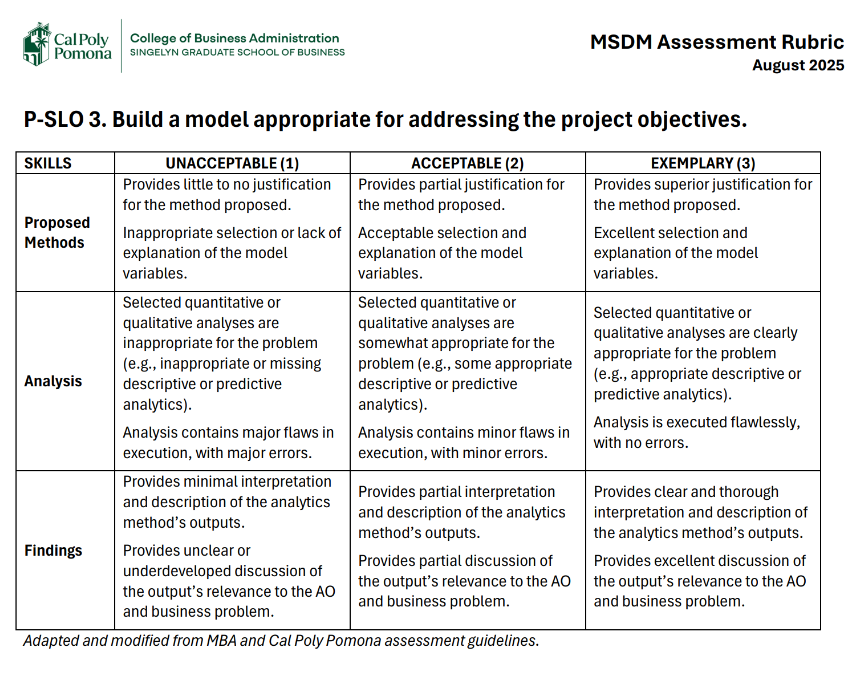
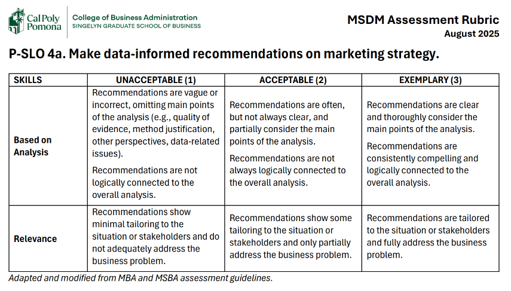

# CHAPTER 1: INTRODUCTION {#sec-ch1-introduction}

## Background and Business Problem

### Background (Georgia Monjarrez)

The Restaurant at Kellogg Ranch (RKR) is a student-operated restaurant on the California State Polytechnic University, Pomona campus. Opened in 1990, it gives students in The Collins College of Hospitality Management practical experience managing restaurant operations while serving the public. Its seasonal dining experience incorporates campus-grown ingredients and views of the university grounds [@therest].

RKR's website connects prospective guests with menu information, posted operating hours, location details, private-event information, and an OpenTable reservation widget [@therest]. For this project, the website is a key touchpoint between learning about the restaurant and planning a visit. The availability of these features does not establish whether visitors can find or use them easily. Assessing that experience will help identify whether content or navigation changes are needed to support prospective guests.

### Business Problem (Luis Ahumada)

The Restaurant at Kellogg's Ranch is currently transitioning from primarily operating as a student-managed instructional restaurant, to a dual model that also includes stand-alone restaurant operation during different days of the week. Because these stand-alone service periods can't rely on state funding, RKR needs to find ways to generate consistent customer demand and revenue while also maintaining its educations Cal Poly Pomona mission. The Project proposal identifies several areas where RKR still needs evidence, including priority customer segments, barriers to visiting, effective messages and content, and the digital customer journey from awareness to reservation and repeat visits (Kwok 2026).

## Project Objectives

The project is designed to achieve the following objectives:

1.  Strengthen the visual design of RKR's section of The Collins Concierge to drive reservation growth.

2.  Identify what RKR guests value most and where improvements are needed to strengthen their overall dining experience.

3.  Develop an evidence-based Facebook marketing strategy designed to support reservation growth at The Restaurant at Kellogg Ranch.

4.  Recommend website content and navigation improvements that make dining information and the reservation process easier for prospective RKR guests to access.

5.  Strengthen RKR's Instagram strategy to improve audience engagement

## Analytics Objectives

### AO1. Newsletter Design and Reservation Growth (Leeann Lewis-Waddell) {#sec-ao1-title-ao1}

- **PO1:** Strengthen the visual design of RKR's section of The Collins Concierge to drive reservation growth.

- **AO1:** Compare "Reserve a Table" click rates and attributed OpenTable reservations across RKR newsletter section designs, testing button placement in Fall 2026 and image versus video in Spring 2027.

  - **Data Source:** Canva website insights from The Collins Concierge will track page views and "Reserve a Table" clicks. Reservations will be tracked in OpenTable through version-specific links.

#### How to address AO1

Using previous issues as a baseline, Fall will test moving the "Reserve a Table" button to the upper left, and Spring will A/B test image versus video. Click-through rate will be the primary metric, with OpenTable reservations as the secondary metric, and results will be compared using a two-proportion test.

#### How AO1 will help achieve PO1

AO1 will help achieve PO1 by identifying which design changes lead to more "Reserve a Table" clicks and reservations. The results will show whether button placement, media, or both have the greatest impact on the RKR section. These findings will give RKR the evidence needed to design a newsletter section that supports reservation growth.

### AO2. Customer Experience Factors Associated With Overall Satisfaction (Carmen Jimenez)

- **PO2:** Identify what RKR guests value most and where improvements are needed to strengthen their overall dining experience.

- **AO2:** Using anonymous post-visit survey responses, compare RKR guests’ ratings of food quality, service quality, and atmosphere/physical environment to identify the strongest and weakest experience areas.

  - **Data Source:** Anonymous post-visit survey responses from RKR guests collected during Fall 2026, with Spring 2027 data added if available.

#### How to address AO2

The survey will measure food quality, service quality, atmosphere and physical environment, overall satisfaction, intention to return, and willingness to recommend using five-point rating items. The analysis will report response counts, percentages, and average ratings. Open-ended comments will be organized into recurring themes related to guest strengths and improvement opportunities.

#### How AO2 will help achieve PO2

The results will identify which parts of the RKR experience guests evaluate most positively and which areas may need improvement. These findings will help RKR prioritize customer-experience improvements that can support guest satisfaction, repeat visits, and positive recommendations.

### AO3. Facebook Content and Messaging Strategies and Reservation Performance (Luis Ahumada)

- **PO3:** Develop an evidence-based Facebook marketing strategy designed to support reservation growth at The Restaurant at Kellogg Ranch.

- **AO3:** Analyze associations between facebook content and messaging strategies, engagement metrics, and OpenTable reservation activity.

- **Data Source:** RKR Facebook posts and Meta Business Suite Analytics including engagement metrics and link clicks; available OpenTable reservation data; and trackable reservation links or QR codes if available.

#### How to address AO3

The plan is to categorize RKR Facebook posts by content and messaging type and compare their performance using available engagenent metrics through Meta. The following step would be to analyze how these results are associated with OpenTable reservation activity. The content categories and analytical methods will depend on the anount and quality of data available.

#### How AO3 will help achieve PO3

AO3 will help achieve PO3 by identifying which Facebook content and messaging strategies are associated with stronger engagement and OpenTable reservation activity. These findings will provide the evidence needed to develop a Facebook marketing strategy that focuses on the most effective content and messaging approaches to support the reservation growth at RKR.

### AO4. Website Content, Navigation, and Usability (Georgia Monjarrez)

- **PO4:** Recommend website content and navigation improvements that make dining information and the reservation process easier for prospective RKR guests to access.
- **AO4:** Measure unassisted task-completion rates, median successful completion time, and five-point ease-of-use ratings for locating RKR’s menu, identifying operating hours, and reaching the reservation interface. Evaluate each task against a proposed 80% unassisted completion benchmark.
  - **Data Source:** Primary observations from task-based tests of the current RKR website and brief post-task survey responses from prospective guests during the project’s data-collection period.

#### How to address AO4

Participants will complete three tasks from the RKR homepage: find the relevant menu, identify posted hours for a specified service period, and reach the interface for starting a reservation. The team will record success without assistance, time in seconds, and an ease rating from 1 (very difficult) to 5 (very easy). Device type, prior familiarity, and recurring navigation difficulties will be documented. Analysis will report completion counts and percentages, median times among successful unassisted attempts, and ease-rating distributions separately for each task. The 80% target is a proposed project benchmark rather than a published usability standard.

#### How AO4 will help achieve PO4

The results will identify which dining-information and reservation tasks create difficulty and explain the observed barriers. Recommendations will connect each proposed content or navigation change to participant evidence, such as unclear labels, hard-to-find hours, or an inconspicuous reservation entry point. This supports PO4 by making the recommendations specific and measurable. Reaching a reservation interface will not be interpreted as a completed reservation or evidence of increased revenue.

### AO5. Instagram Content and Engagement Analysis (Spencer Conway)

- **PO5:** Strengthen RKR’s Instagram strategy to improve audience engagement.

- **AO5:** Determine which Instagram content format produces the highest engagement rate for Restaurant at Kellogg Ranch.

  - **Data Source:** RKR Instagram posts and Instagram Insights data, including likes, comments, shares, saves, and reach. New Instagram posts may also be tested in selected formats if enough data and time are available.

#### How to address AO5

The plan is to group RKR’s past Instagram posts by format, such as single-image posts, carousels, and Reels, and compare their engagement rates. Engagement rate will be calculated using likes, comments, shares, and saves divided by reach, where the data is available. This will create a baseline for how each format has performed. RKR can then test new content in selected formats and compare the results with the historical baseline.

#### How AO5 will help achieve PO6

AO5 will help achieve PO6 by identifying which Instagram formats are associated with stronger audience engagement. These findings will give RKR evidence for which types of Instagram content they should prioritize moving forward and help create a more data-informed Instagram strategy.

## Significance of the Topic

This project is important because it can help Restaurant at Kellogg Ranch better understand how its marketing efforts can increase awareness and engagement with its target audiences. Research has shown that restaurant social media content can influence customer inspiration and engagement, especially when restaurants use appealing outcome-focused food imagery [@lee2026]. RKR has a unique connection to The Collins College and Cal Poly Pomona, but that does not automatically mean students, faculty, staff, or people in the surrounding community know about the restaurant or what it offers. By looking at different marketing channels and customer touchpoints, our group can identify ways RKR can improve how it communicates with potential customers. Social media marketing activities such as interaction, entertainment, trendiness, and customization have been found to influence perceived value, purchase intention, and electronic word-of-mouth [@bushara2023]. Using data to evaluate current marketing efforts can also help the restaurant make decisions based on actual results instead of assumptions. The project can also support a more consistent and data-driven marketing strategy moving forward. Understanding how different audiences respond to different types of communication may help the restaurant use its marketing resources more effectively and build stronger connections with both the Cal Poly Pomona community and customers outside of campus.

------------------------------------------------------------------------

# CHAPTER 2: BACKGROUND AND ANALYTICS OBJECTIVES

## Client (Company) Background

The Restaurant at Kellogg Ranch (RKR) is located at California State Polytechnic University, Pomona, and is part of The Collins College of Hospitality Management. Established in 1990, RKR has traditionally operated as a student-managed restaurant and learning laboratory where hospitality students gain hands-on experience in restaurant operations, food preparation, customer service, and management [@collins_rkr].

RKR is transitioning toward a dual operating model that combines its educational purpose with stand-alone restaurant operations. According to the initial project proposal prepared by Dr. Linchi Kwok, this emerging model may allow the restaurant to operate with paid staff on three weekdays while continuing to serve as a classroom laboratory on designated instructional days[@kwok2026].

This transition represents an important business challenge because stand-alone restaurant services must generate sufficient customer demand and revenue to support financially sustainable operations. Therefore, attracting guests, increasing reservation activity, and encouraging repeat visits are important priorities while maintaining RKR's educational identity [@kwok2026].

### Company Mission/Vision

RKR's educational mission is closely connected to Cal Poly Pomona's emphasis on experiential learning. The restaurant provides students with opportunities to apply classroom knowledge in a professional dining environment, develop practical hospitality skills, and gain experience serving real customers. Through this learning model, students develop skills in teamwork, leadership, service, and restaurant management [@collins_rkr].

Although a separate official mission and vision statement for RKR has not been identified in the available materials, its current strategic direction is outlined in the initial project proposal. RKR seeks to preserve its educational purpose while developing sustainable restaurant operations that can attract customers and generate revenue independently of instructional support [@kwok2026].

From this perspective, RKR's long-term direction involves balancing hospitality education with successful restaurant operations. This means continuing to provide meaningful learning opportunities for students while maintaining a dining experience that meets customer expectations and encourages guests to return.

### Core Competencies

One of RKR's main competencies is its ability to combine hospitality education with actual restaurant operations. As part of The Collins College of Hospitality Management, students gain practical experience in different areas of the restaurant, including food preparation, guest service, leadership, and management. This educational connection gives RKR an identity that differs from traditional restaurants[@collins_rkr].

Another important strength is the restaurant's culinary offering and physical environment. RKR features seasonal menus with farm-to-table-inspired dishes, including ingredients sourced from Cal Poly Pomona's agricultural resources. Its location also provides scenic campus views, creating an attractive atmosphere for guests [@rkr_sourcing].

According to the initial project proposal, RKR also benefits from campus and alumni connections, established social media accounts, and access to reservation information. These resources provide opportunities to reach potential customers, better understand guest behavior, and improve marketing effectiveness.

Additionally, the arrival of a new general manager and executive chef provides an opportunity to strengthen the restaurant's operations, culinary offerings, and market positioning. However, these strengths alone do not guarantee sufficient customer demand. RKR still needs to better understand its target audiences, customer motivations, and the marketing channels that are most effective in attracting reservations [@kwok2026].

### Value Propositions

RKR offers a distinctive value proposition by combining a restaurant dining experience with the educational identity of Cal Poly Pomona. Guests can enjoy seasonal meals, fresh ingredients, and an attractive campus setting while supporting the professional development of future hospitality leaders [@rkr_menu].

Its culinary offerings, restaurant atmosphere, and connection to the university are important elements that may help differentiate RKR from traditional restaurants. These characteristics may appeal to campus audiences, alumni, local residents, and customers looking for a unique dining experience.

However, the initial project proposal identifies an important area that requires further investigation: whether customers are more attracted by RKR's culinary experience, its educational mission, or a combination of both. Understanding which aspects customers value most can help the restaurant communicate its strengths more effectively and develop marketing messages that appeal to different audiences[@kwok2026].

Customer perceptions are especially important because the restaurant's educational identity alone may not be enough to encourage repeat visits. Food quality, service quality, and the physical environment can also influence customer satisfaction and future behavioral intentions. Understanding these elements can help RKR improve the dining experience and strengthen its overall value proposition [@ryu2012].

### Business Objectives

RKR's main business objective is to develop sustainable customer demand and generate sufficient revenue to support its stand-alone restaurant operations while preserving its educational mission. As the restaurant transitions toward a dual operating model, attracting guests, increasing reservations, and encouraging repeat visits are important priorities [@kwok2026].

The initial project proposal identifies several objectives that support this direction, including understanding RKR's market position, identifying priority customer segments, analyzing reservation patterns, evaluating the digital customer journey, and improving marketing effectiveness [@kwok2026].

Another important priority is understanding and improving the customer experience. Evaluating guest perceptions of food quality, service quality, atmosphere, and overall satisfaction can help RKR identify strengths and opportunities for improvement. Feedback regarding intention to return and willingness to recommend can also provide useful information about customers' future behavioral intentions [@ryu2012].

Digital marketing is another key focus. RKR needs to better understand how its website, email communications, and social media content contribute to customer engagement and reservation-related activity. Analyzing this information can help identify more effective communication strategies and opportunities to improve the customer journey from initial awareness to reservation.

These business priorities provide the foundation for the team's Capstone Experience Project, which examines newsletter design and reservation activity, customer satisfaction and dining experience, Facebook content performance, website usability, and Instagram engagement.

Together, these areas of investigation support RKR's broader goal of developing a measurable and repeatable demand-generation system. By using customer feedback, reservation information, and digital marketing performance data, RKR can make more informed decisions about its marketing activities and guest experience while continuing to support hospitality education.

## Description of the Client’s Current Marketing Program

### Marketing Team and Expertise

The RKR’s current marketing team is made of several people and platforms rather than being run through one main restaurant marketing team. Current marketing communication includes RKR’s instagram account, The Collins Concierge Newsletter, social channels that are ran by the Collins College of Hospitality marketing team, the RKR website, and third-party platforms such as Google, Yelp, and OpenTable.

Our CEP proposal also identifies that the executive chef is important to RKR’s changing market position, guest experience, and content strategy [@kwok2026]. RKR’s Head Chef has access to his own personal professional Instagram and LinkedIn accounts, which can provide our group another path to highlight the restaurant. Student involvement, and behind the scenes content. The one issue is that the Head Chef does not provide access to his accounts, so they are not identified as official RKR marketing channels. RKR currently has different methods of reaching customers, but as stated before, communication is handled across different people and platforms. So having better coordination between these channels could help RKR maintain a consistent messaging strategy as the restaurant continues to grow.  

### Current Target Market

The RKR’s current position and location present a strong opportunity to reach different groups of customers. The connection to the Collins College of Hospitality Management and its Location on Cal Poly Pomona’s campus can present different content strategies that can be used across the different channels that are available. Some groups that could be targeted include students, CPP staff, Pomona corporate companies that could visit the restaurant during official business meetings, and the Pomona community. 

The restaurant can also attract customers who want something that is different from the typical dining experience. Campus-grown ingredients, student managed service, and connections to Cal Poly Pomona’s educational mission gives customers more reasons to visit beyond the food itself. RKR’s seasonal menu and location should also be used to bring in customers who are interested in supporting the university while also going through a fine dining experience. So, although the RKR has the potential to attract a variety of customers, its primary audience has not yet been clearly established by our group. A closer look at reservation activity and digital engagement may provide us with insight into who is interacting with the restaurant and help guide future marketing decisions.

### Current Positioning and Perceptual Map

The RKR provides a dining experience that combines fine dining services with the educational mission of Cal Poly Pomona’s Collins College of Hospitality Management. Because RKR is a student operated restaurant, RKR allows students to gain hands-on experience in all aspects of fine dining restaurant operation including making positive guest experiences and services a priority. Its seasonal menu, use of campus grown ingredients, and connection to CPP’s agricultural programs also play a role in what makes the restaurant different from the other fine dining experiences in the surrounding Pomona area. 

RKR’s connection to CPP is a vital part to its identity, but its fine dining experience is just as important when considering the restaurant's current position in the local market. The RKR offers its guests the opportunity to enjoy a high-quality , carefully prepared meal; while also supporting the professional experience of future hospitality professionals. Together, these elements give the RKR a very unique identity that combines the quality that comes with fine dining and an experience that is tightly connected to the university’s mission. 

In order to examine how the RKR compares with local restaurants, our team developed a perceptual map that includes local surrounding restaurants that fall under teh “fine-dining” category. These restaurants include Pomona Valley Mining Company, Coco Palm, The Derby, and VITA Italian Bar & Grill. The map compares the restaurants based on two dimensions. One being the type of dining experience and the second being the dining atmosphere. The dining experience ranges from traditional to unique, while the dining atmosphere ranges from casual to special occasion or upscale. 


The reason for the RKR’s current placement on the map is because its student-operated setting and connection to CPP helps separate it from its competitors that offer more traditional upscale dining experiences. But, the map also reflects the team's assessment of each restaurant based on its characteristics rather than customer feedback. Performing more research could help our group determine how guests actually perceive RKR and whether its current positioning on our map aligns with those perceptions of the public. 

### Current Product/Services

The Restaurant at Kellogg Ranch (RKR) provides public lunch and dinner service within a student-operated hospitality training restaurant at Cal Poly Pomona. Its offering combines seasonal dining, student-delivered service, and views of the campus. The website also promotes the restaurant as a setting for business dinners, family celebrations, and large parties or events. [@therest].

The published menus include starters, salads, sandwiches, entrées, desserts, and beverages, with dietary options identified. [@rkr_menu]. Campus partnerships supply ingredients and beverages, including produce from university farms, campus-produced honey, Horsehill wines, and Innovation Brew Works beer. These partnerships help distinguish RKR’s offering through its connection to Cal Poly Pomona and locally sourced food. [@rkr_sourcing].

These characteristics directly support AO2, which compares guest ratings of food quality, service quality, and atmosphere or physical environment. Together, these dimensions represent the core experience RKR provides. The restaurant’s promotional descriptions establish what it offers and emphasizes, while the planned post-visit survey will assess how guests actually evaluate that experience. Seasonal dishes and campus sourcing also provide potential content subjects for the newsletter, Facebook, and Instagram work in AO1, AO3, and AO5.

### Current Pricing

RKR’s published fall menus use individual item pricing. Lunch entrées range from \$15 to \$23, while lunch sandwiches range from \$18 to \$20. Individual dinner entrées range from \$16 to \$24, and a sirloin entrée intended for two guests is listed at \$48. Desserts are priced at \$12 each. These amounts describe listed items rather than complete meal totals. [@rkr_menu].

| Menu category             | Published price |
|---------------------------|----------------:|
| Lunch entrées             |       \$15–\$23 |
| Lunch sandwiches          |       \$18–\$20 |
| Individual dinner entrées |       \$16–\$24 |
| Sirloin entrée for two    |            \$48 |
| Desserts                  |            \$12 |
| Wine by the glass         |        \$6–\$10 |
| Beer                      |         \$6–\$8 |

Source: RKR’s published fall menus [@rkr_menu].

Pricing provides practical information prospective guests can use when planning a visit. This relates to AO4 because finding the menu should give visitors access to relevant dining information, including prices. However, successful navigation does not establish that customers consider those prices affordable or worthwhile. Price perceptions are also outside AO2’s primary comparison of food, service, and atmosphere. The team should therefore describe current prices without claiming that the project will determine an optimal pricing strategy. Pricing rationale, discounts, and private-event rates require client confirmation.

### Current Marketing Channels

RKR delivers its dining service directly through its campus restaurant in Building 79 at 3801 West Temple Avenue in Pomona. Its contact page provides location directions, telephone and email contact information, and complimentary parking in Lot L with a reservation. Posted hours are Monday through Friday, 11 a.m.–2 p.m., for lunch and Tuesday through Friday, 5–8 p.m., for dinner, beginning August 24. [@rkr_contact].

The website provides an OpenTable reservation widget, while walk-ins are also welcome. [@therest]. The team’s existing report identifies additional customer outreach through The Collins Concierge newsletter, Facebook, and Instagram. These communication channels can introduce guests to RKR and direct them toward dining information or the reservation process.

This channel structure explains the relationship among the project’s AOs. AO1 examines newsletter clicks and attributed reservations; AO3 examines Facebook engagement and its association with OpenTable activity; AO5 compares Instagram engagement across formats. AO4 examines whether visitors can find the menu, identify hours, and reach the reservation interface. These are distinct stages of the customer journey. Reaching the reservation interface does not confirm a booking, and reservation records alone do not capture walk-in visits.

### Current Integrated Marketing Communications

RKR’s website emphasizes seasonal food, campus sourcing, hospitality education, welcoming service, and scenic views. It includes guest testimonials and directs visitors to [RKR’s Instagram account](https://www.instagram.com/rkr_cpp/) for team updates, seasonal menu changes, and special events. [@therest]. The sourcing page reinforces the campus connection, while the “Our Story” page presents the restaurant’s educational origins and lists awards and recognitions. [@rkr_sourcing; @rkr_story].

The team’s report also documents an RKR promotional section in The Collins Concierge containing menu information, hours, and a reservation link. It identifies Facebook and Instagram as additional channels under investigation. Together, these activities provide several opportunities to communicate the restaurant’s offering and encourage a visit. However, their presence does not establish that messaging, schedules, or reservation links are coordinated across channels.

AO1, AO3, and AO5 address different aspects of communication performance: newsletter design, Facebook content and messaging, and Instagram formats. AO4 complements this work by assessing access to the information and reservation interface that prospective guests need next. The shared implication is that communication should be evaluated through both audience response and subsequent actions where measurable. Higher engagement alone should not be presented as evidence of increased reservations. Client information about campaign planning, content approval, and tracking is needed to assess the integration of RKR’s communications.

## Description of the Company’s Current Digital Marketing Practices

### Brand Persona

The Restaurant at Kellogg Ranch carries a personality shaped by its setting and its connection to the Collins College of Hospitality Management. Its location on the historic Kellogg Ranch gives it a traditional, wholesome character rooted in place and heritage, while its role as a campus restaurant gives it a welcoming, approachable feel for students, faculty, staff, and the surrounding community. Together, these qualities position RKR as a warm, classic dining destination where guests can enjoy a polished meal without the formality of a high-end restaurant.

These traits matter because consumers naturally think about brands as if they were people. Brand personality is the set of human traits people attribute to a product or business, and consumers commonly compare brands on familiar dimensions such as traditional and wholesome, lively and surprising, or glamorous and romantic [@solomon]. RKR fits most closely with the traditional and wholesome dimension, and keeping that personality consistent across its menus, service, and communications helps guests form a clear and memorable impression of the restaurant.

### Digital Marketing Channels/Medium (Spencer Conway)

RKR uses its website, The Collins Concierge newsletter, and social media to share restaurant information. These channels help people learn about RKR, see what it offers, and find out how to make a reservation.

#### Website and Landing Page

RKR’s website has menus, hours, location information, and an OpenTable reservation option [@therest]. Customers can use it to find the information they need before visiting. We still need to confirm whether RKR has separate landing pages for specific promotions. For AO4, we will look at how easily people can find the menu, hours, and reservation option.

#### Keyword Research and SEO

We still need to find out whether RKR uses keyword research or has an SEO strategy. Just having a website does not mean people can easily find it through Google. Website search reports could help us see what people search for and how they find RKR online.

#### Email Marketing

RKR has a section in The Collins Concierge newsletter that includes restaurant information and a “Reserve a Table” button. For AO1, we will compare changes to the button placement and the use of images or video. Canva views and clicks will help us compare the versions, but we will need tracking information to see whether those clicks lead to reservations.

#### Social Media Posting

Our project focuses on RKR’s Facebook and Instagram channels. These platforms give RKR a way to share food, student involvement, restaurant atmosphere, and events. AO3 will focus on Facebook content and messaging. AO5 will compare Instagram formats, including single-image posts, carousels, and Reels. We will use the available data to see which approaches get more engagement.

#### Paid Search Advertising

We still need to confirm whether RKR uses paid search ads, such as Google Ads. If it does, we will need to review the spending, keywords, clicks, and any tracked reservations to understand how the ads are doing.

#### Social Media Advertising

We also need to find out whether RKR pays for Facebook or Instagram ads or boosts posts. Paid posts may reach more people than regular posts, so we will need to account for that when comparing engagement.

#### Display Advertising

We have not confirmed whether RKR uses display ads, such as banner ads on other websites. We will ask the client whether these ads are being used and what results are available.

### Other Digital Marketing Channels & Tactics (Georgia Monjarrez)

Beyond the website, newsletter, and social media channels discussed in Section 2.3.2, this section considers RKR's use of conversion rate optimization, mobile applications, affiliate marketing, and influencer campaigns. The project team has not yet confirmed formal programs in these areas. The discussion therefore distinguishes proposed project activities from established restaurant practices.

#### Conversion Rate Optimization (CRO)

For this project, conversion rate optimization focuses on helping interested customers complete a desired action. Relevant actions include clicking the newsletter's “Reserve a Table” button and accessing the reservation process through RKR's website, which provides an OpenTable reservation option [@therest]. Completed reservations represent a separate outcome that requires additional tracking.

As described in the team's analytics objectives, AO1 will test whether changes to newsletter visuals and reservation-button placement increase clicks. AO4 will evaluate how easily website users find the menu, locate operating hours, and reach the reservation process. These planned analyses could identify barriers between customer interest and action. However, the team has not confirmed whether RKR currently conducts regular conversion testing or maintains an ongoing CRO program.

#### Mobile Application

The team has not identified a dedicated RKR mobile application in the materials reviewed for this report. The restaurant's website and OpenTable reservation access provide existing digital pathways for customers to obtain information and plan a visit [@therest]. These pathways should be distinguished from a restaurant-owned application.

For this project, evaluating the website experience on mobile devices could help determine whether customers can easily access essential dining information and reservation options. Any assessment should document the devices used and the navigation issues observed before drawing conclusions about mobile usability.

#### Affiliate Marketing

The team has not confirmed an affiliate marketing program through which RKR compensates partners for generating referrals or reservations. University communications and potential partnerships with campus organizations or local businesses should not automatically be classified as affiliate marketing.

To establish whether this tactic is currently used, the team would need information about formal referral agreements, partner compensation, and methods for tracking resulting customer actions. Until such arrangements are confirmed, affiliate marketing remains an unverified practice.

#### Influencer Campaigns

The team has not confirmed a formal RKR influencer campaign involving paid or otherwise compensated promotional partnerships. As noted in the Marketing Team and Expertise section, the executive chef's personal professional accounts have been identified as potential sources of visibility, but they are not official RKR channels available to the project team. Their existence alone does not establish an influencer marketing program.

If RKR has worked with content creators, further information would be needed about campaign arrangements, content, audience reach, and measurable outcomes. Organic guest posts and independent restaurant coverage should also be distinguished from coordinated influencer campaigns.

### Allocation of Resources to Customer-Influence Efforts (Luis Ahumada)

#### Demand Generation

RKR’s focus when it comes to demand generation is creating awareness and giving potential customers reasons to visit RKR. Current channels include social media (RKR Instagram, The Collins College of Hospitality Management Facebook page), The Collins Concierge newsletter, the RKR website, and other university related communication. These channels can highlight the restaurant’s seasonal menu, student involvement, campus-grown ingredients, scenic setting, and special dining experience.

Different audiences are also reached through the different channels being used, making them key to influencing potential customers. The Collins Concierge focuses on the CPP community which includes staff and students, while Instagram and Facebook can help reach not only students and faculty, but alumni and members of the local community. Our team’s customer analysis identifies faculty, staff, and students as the strongest current target because they’re on campus and can be reached through existing university communication.

#### Demand Harvesting

The main tools that are used to harvest demand for the RKR are the RKR website and the OpenTable reservation system. The website provides menu information, visitor information, and access to reservations, which provides a direct path to its customers from learning about the restaurant to starting a reservation.

#### Loyalty Building

There is currently no loyalty program, so RKR’s current loyalty building efforts heavily depend on the dining experience and continued communication. One key influence that may lead to customers coming back is the consistent quality of the food service, atmosphere, pricing, and continued exposure to RKR through digital channels.  faculty, staff and students may be the best opportunity for repeated visits because they are on campus regularly and use the RKR for weekday lunches, meetings, and dinners. Alumni may also be a strong group to target because they have an existing connection to Cal Poly Pomona.

Our group has not currently identified a formal loyalty or rewards program for RKR, so the customer survey, reservation data, and repeat visit information can provide  a better understanding of loyalty once those pieces of data are available.

### Analytics Infrastructure

The Restaurant at Kellogg Ranch (RKR) uses several digital platforms to communicate with customers, promote its dining services, and manage reservations. These platforms also provide opportunities to collect information about marketing performance and customer engagement. The main tools identified in this project include Canva, Facebook and Instagram analytics, OpenTable, and website performance reports.

One of RKR's communication channels is The Collins Concierge, a newsletter created using Canva. This newsletter helps share restaurant information and encourages readers to make reservations. Canva may provide information about how readers interact with the newsletter, including views and clicks on the "Reserve a Table" button. These metrics could help RKR understand whether changes to the newsletter's layout and content influence customer interest. However, additional tracking would be needed to determine whether those clicks result in actual reservations.

Facebook and Instagram are also important channels for RKR's digital marketing activities. Through Meta Business Suite and Instagram Insights, the restaurant may be able to review metrics such as reach, impressions, likes, comments, shares, and other interactions. This information can help identify which posts attract more attention and how audiences respond to different types of content. However, access to these metrics depends on the restaurant's account settings and the data available to the project team.

OpenTable is another important platform because customers can use it to make reservations online. Reservation data could help RKR understand booking activity and identify patterns across different periods. One limitation is that the team has not yet confirmed whether OpenTable data can show which marketing channels or campaigns led customers to make a reservation.

Website analytics can also help RKR understand how people find and use its website. Information such as website visits, traffic sources, and page engagement could show which pages receive the most attention and where improvements may be needed. The project team will need to confirm which website reports are available and what information they contain.

Although these platforms can provide useful information, it is not yet clear how RKR combines data from different sources to evaluate its marketing performance. For example, someone may see an Instagram post, visit the website, and later make a reservation through OpenTable. Without a way to connect those interactions, it is difficult to determine which marketing activities contribute to reservations.

Improving how these data are collected and reviewed could help RKR make better marketing decisions. Using consistent key performance indicators (KPIs), reviewing results regularly, and tracking reservation-related interactions where possible would help the restaurant better understand its customers and evaluate its digital marketing efforts.

## 2.4 Competitive Analysis

RKR competes with restaurants in Pomona and the surrounding area. Customers may compare food, prices, atmosphere, location, and available dining times when choosing a restaurant. Our proposed comparisons are Pomona Valley Mining Company, Coco Palm, The Derby, and VITA Italian Bar & Grill. We still need to confirm which restaurants RKR considers its closest competitors.

### Industry Size

The figures below describe the broader U.S. restaurant and foodservice industry. They provide background for the project but do not measure the size of RKR’s local market.

#### Number of Companies

We have not yet confirmed the number of restaurant companies in RKR’s local market. Before finding this number, our team needs to define the area and types of restaurants included in the comparison. A count of restaurant locations would also be different from a count of companies, since one company may operate several locations.

#### Number of Employees

The National Restaurant Association’s initial 2026 forecast projected total U.S. restaurant and foodservice employment of 15.8 million people [@nra2026]. This shows the size of the national industry, but we have not yet obtained an employment estimate for RKR’s local market.

#### Annual Revenue and Key Financial Information

The National Restaurant Association’s initial forecast projected U.S. restaurant and foodservice sales of \$1.55 trillion in 2026 [@nra2026]. In July, the association updated its expected annual sales growth to 4.3%, or 0.8% after adjusting for inflation. The update also reported uneven customer traffic and high operating costs [@nra2026update].

These conditions suggest that restaurants need to give customers a clear reason to visit. For RKR, we think its student-run experience, seasonal menus, and campus-grown ingredients could help communicate its value [@therest]. We have not obtained comparable annual revenue figures for RKR and the selected competitors.

#### Existence of Dominant Players and Competitors

Our analysis focuses on restaurants that could appeal to customers looking for a similar dining occasion. We have not established that any of these restaurants dominates the local market.

Pomona Valley Mining Company and Coco Palm were selected as nearby comparisons because both promote scenic dining [@pomona_mining; @coco_palm]. The Derby in Arcadia provides a regional comparison for upscale dining and special occasions [@derby]. VITA Italian Bar & Grill offers another Pomona option and emphasizes Italian food, local ingredients, and its dining atmosphere [@vita].

| Restaurant | Main offering | Digital marketing features | What this means for RKR |
|:-----------------|:-----------------|:-----------------|:-----------------|
| **RKR — Pomona** | Student-run restaurant with seasonal food, campus-grown ingredients, and hillside views [@therest]. | Website includes menus, visitor information, OpenTable reservations, and an Instagram link [@therest]. | Student involvement and campus ingredients give RKR different topics to feature in its content. |
| **Pomona Valley Mining Company — Pomona** | Hilltop dining, Sunday brunch, and private events [@pomona_mining]. | Website promotes holiday meals and events, provides menu information, and links to OpenTable reservations [@pomona_mining]. | Competes for scenic dining and celebrations. Its website connects promotions to a clear reservation option. |
| **Coco Palm — Pomona** | Cuban dining with city views and space for special occasions [@coco_palm]. | Website provides menus, reservations, online ordering, and event information [@coco_palm]. | Offers another option for local customers looking for a meal with a view or a celebration venue. |
| **The Derby — Arcadia** | Upscale steakhouse with a long history and a focus on its dining atmosphere [@derby]. | Website shares the restaurant’s history, food and interior photos, reservation links, and group-dining information [@derby]. | Shows how a restaurant can use its story and atmosphere to give customers a reason to visit. |
| **VITA Italian Bar & Grill — Pomona** | Italian dining with local ingredients, an outdoor terrace, and Sunday brunch [@vita]. | Website features menus, reservation links, food photos, brunch promotions, and cooking classes [@vita]. | Provides another nearby dining option. Its food and event promotions give us ideas for content RKR could test. |

*The table compares visible website features. It does not show which restaurant has better marketing results.*

This comparison supports our analytics objectives by identifying content and customer actions to evaluate. For AO5, we could compare Instagram posts about food, students, and the dining atmosphere to see which receive more engagement. The newsletter and website objectives could examine whether menu information and reservation links encourage customers to take the next step. Reservation-link clicks should be measured separately from completed reservations.

#### Market Share of Each Major Player

We have not found reliable market-share figures for RKR or the selected competitors. Calculating revenue-based market share would require each restaurant’s sales and total sales for a clearly defined market during the same period.

Because these figures are not available to our team, we cannot estimate each restaurant’s market share. Social media followers and online reviews may help compare online visibility, but they do not measure market share.

### Industry Outlook

#### Industry Life Cycle

#### Future Sales/Profit Growth Outlook

### Key Competitors and Their Digital Marketing Strategies

#### Target Market

#### Positioning

#### Website and Landing Page

#### Keyword research and SEO

#### Email Marketing Strategy

#### Social Media Posting

#### Paid Search Advertising

#### Social Media Advertising

#### Display Advertising

#### Conversion Rate Optimization (CRO)

#### Mobile Application

#### Affiliate Marketing

#### Influencer Campaigns

#### Summary Table of Comparison

## Customer Analysis

### Segments and Their Brief Justification

#### Segment A: Cal Poly Pomona Faculty and Staff

This segment includes faculty, staff, and administrators who work on campus. They are likely working adults with steady schedules and limited time during the day. RKR's weekday lunch hours, from 11 a.m. to 2 p.m., fit their routine [@rkr_contact]. These guests may value convenience, a quality meal close to work, and a setting suited for department lunches or meetings with colleagues. Many also have a personal connection to the university and may want to support its students. We expect this group to visit most often at lunch and to return if the experience is consistent. The Collins Concierge already reaches part of this audience, which makes it the most direct segment to test through AO1.

#### Segment B: Cal Poly Pomona Students

This segment includes undergraduate and graduate students, including hospitality students and their peers. Most are younger diners who are active on social media. They may be more price-conscious than other segments, since lunch entrées range from \$15 to \$23 [@rkr_menu]. On the other hand, RKR accepts Bronco Bucks, which may make a visit easier to justify. Students may look for a social outing, a special meal, or a place to bring visiting family. We expect visits to be occasional and tied to events such as birthdays, family visits, or graduation. Instagram is likely the strongest way to reach this group, which connects to AO5.

#### Segment C: Local Professionals and Business Groups

This segment includes employees of Pomona-area companies and organizations who need a place for business meals. The RKR website already promotes the restaurant for business dinners and large parties [@therest]. These guests may value a professional atmosphere, reliable service, and easy reservations. RKR's farm-to-table menu and campus setting could also give business hosts a unique place to bring clients. We expect this group to book in advance and to dine in larger parties. However, RKR does not currently have a confirmed channel that targets this group. The executive chef's LinkedIn could help, but it is not an official RKR channel.

#### Segment D: Alumni and the Local Community

This segment includes Cal Poly Pomona alumni and residents of Pomona and nearby cities. Alumni may feel loyalty to the university, while local residents may be looking for something different from a typical night out. Both groups may value the scenic views, seasonal menu, and campus-grown ingredients [@rkr_sourcing]. We expect this segment to visit for celebrations such as birthdays, anniversaries, and family gatherings. Notably, this segment compares RKR most directly with Pomona Valley Mining Company and Coco Palm, which also promote scenic dining. RKR does not offer weekend service, which may limit visits from guests who celebrate on Saturdays or Sundays [@rkr_contact].

#### **Summary Table of Segments**

| Characteristic | Segment A: Faculty and Staff | Segment B: Students | Segment C: Local Professionals | Segment D: Alumni and Local Community |
|---------------|---------------|---------------|---------------|---------------|
| **Demographics** | Working adults employed on campus | Undergraduate and graduate students | Employees of Pomona-area companies | Alumni and residents of Pomona and nearby cities |
| **Psychographics** | Busy, connected to the university, supportive of students | Social, active online, budget-aware | Professional, focused on impressions and reliability | Loyal to CPP or looking for a unique local experience |
| **Benefits sought** | Convenience, quality lunch, meeting space | Social outing, special occasion meal, value | Professional setting, dependable service, easy booking | Scenic views, seasonal food, a memorable celebration |
| **Behavioral patterns** | Frequent weekday lunch visits | Occasional, event-driven visits | Advance bookings for larger parties | Special-occasion visits, often on evenings |
| **Likely channels** | The Collins Concierge, campus email | Instagram, Facebook | Website, Google, LinkedIn | Instagram, Facebook, Google, Yelp, alumni outreach |

### Segment Analysis

Each segment was evaluated on four criteria. Identifiability is whether the group can be clearly defined and measured. Actionability is whether RKR can serve the group with its current menu, hours, and resources. Substantiality is whether the group is large enough or spends enough to support demand. Accessibility is whether RKR can reach the group through its existing channels.

Faculty and staff rate highest overall. They are easy to identify, they are on campus during lunch hours, and the Concierge newsletter already reaches part of this group. Their total size is still unknown, so substantiality is rated medium until reservation data can confirm it.

Students are easy to identify and reach through Instagram. On the other hand, menu prices may limit how often they visit, and their spending per visit is likely lower than other segments. As such, students rate lower on actionability and substantiality.

Local professionals fit the business dining the website already promotes. However, RKR has no official channel aimed at this group, and its size in the Pomona area has not been measured. This makes accessibility the weakest point for this segment.

Alumni and the local community are a large potential audience with clear reasons to visit. RKR can reach them through social media and review sites, but competition for scenic and special-occasion dining is strong. The lack of weekend service also limits how well RKR can serve them.

#### **Summary Table of Segment Evaluation**

| Criterion | Segment A: Faculty and Staff | Segment B: Students | Segment C: Local Professionals | Segment D: Alumni and Local Community |
|---------------|---------------|---------------|---------------|---------------|
| **Identifiability** | High | High | Medium | Medium |
| **Actionability** | High | Medium | Medium | Medium |
| **Substantiality** | Medium | Medium | Medium | High |
| **Accessibility** | High | High | Low | Medium |
| **Overall attractiveness** | High | Medium | Low to Medium | Medium to High |

Based on this evaluation, faculty and staff are the most attractive primary target. This segment fits RKR's weekday hours, is reachable through channels RKR already uses, and can be measured directly through AO1. Alumni and the local community are recommended as a secondary target because of their size and their interest in celebration dining. Reaching them will depend on stronger social media content, which AO3 and AO5 will help evaluate. These choices are based on our team's assessment and should be confirmed with OpenTable reservation data and AO2 survey responses.

## SWOT Analysis

### Strengths

### Weaknesses (Spencer Conway)

One possible weakness is that RKR’s marketing is managed by different people across several platforms. This could make it harder to keep information updated and messages consistent between the website, newsletter, and social media. We still need to ask the client how these activities are coordinated.

Another weakness is that it is difficult to connect marketing activity to actual reservations. Someone liking a post or clicking a newsletter link shows interest, but it does not mean they booked a table. Without consistent tracking, it is harder to know which marketing efforts are bringing in customers.

RKR’s weekday hours may also limit who can visit. People who work during lunch or prefer to go out on weekends may have fewer chances to eat at the restaurant. This could make it harder to reach some customers outside the university.

The current newsletter section mainly uses text, and the reservation button is below the restaurant information. Readers who quickly scan the newsletter might overlook it. AO1 will test whether changing the button placement and adding visuals helps increase clicks. We will need the results before saying whether these changes work.

### Opportunities

The Restaurant at Kellogg Ranch (RKR) has several opportunities to increase its visibility and attract more customers, both within Cal Poly Pomona and in the surrounding community. These opportunities are related to its potential customer segments, digital marketing channels, and partnerships with local and university organizations.

One opportunity is reaching more people within the Cal Poly Pomona community. Faculty, staff, students, alumni, and campus visitors represent different groups that may be interested in dining at RKR. For example, faculty and staff may consider the restaurant for lunch meetings, while alumni and campus visitors may be interested in special dining occasions. Developing marketing messages for these different groups could help increase awareness of the restaurant and encourage reservations.

Another opportunity is reaching customers outside the university. RKR is located near residential communities and businesses in Pomona and the surrounding area. Local residents and professionals may be interested in discovering new dining options for lunch, celebrations, or social gatherings. Increasing RKR's visibility through digital channels could help introduce the restaurant to people who are not familiar with its dining services.

Social media also creates opportunities to connect with potential customers. Instagram and Facebook allow restaurants to share photos, videos, menu updates, and information about the dining experience. By testing different types of content and reviewing audience engagement, RKR could learn which messages are more effective in attracting attention and encouraging people to explore its reservation options.

RKR may also benefit from greater collaboration with university departments, alumni groups, student organizations, and local businesses. These connections could help the restaurant reach new audiences and promote dining opportunities for meetings, celebrations, and group events. Any promotional activities would need to align with the restaurant's operating hours and reservation capacity.

Finally, the availability of digital analytics and customer feedback presents an opportunity to improve marketing decisions. By reviewing newsletter engagement, social media performance, website activity, and guest survey responses, RKR could better understand customer interests and identify areas where its marketing efforts can be improved.

Overall, these opportunities could help RKR expand its reach and strengthen customer engagement. However, their potential impact will depend on customer demand, the restaurant's operational capacity, and the results of the marketing analyses conducted during this project.

### Threats (Luis Ahumada)

Customers have several restaurant options to choose from within the local and surrounding Pomona area, making it competitive for RKR. There are other restaurants such as the Pomona Mining Co. and Coco Palm that compete for some of the same dining occasions. Customers who usually dine with the competitors are looking for specialty dining with a scenic view, so RKR will need to find a way to stand out compared to its competitors.

Another threat is that customers outside of Cal Poly Pomona are not limited to campus dining options, so they may not know that the RKR exists. Another threat is that other restaurants offer weekend services, have longer hours, or are more familiar with the dining experience. This is important to consider because it puts the RKR at a disadvantage to begin with. The restaurant industry is also currently dealing with uneven customer traffic and high operating costs, which leads to customers being more selective about how much they eat out and where they choose to spend their money.

### Summary: SWOT Quadrants (Georgia Monjarrez)

The following SWOT matrix summarizes RKR's internal strengths and weaknesses and the external opportunities and threats affecting its ability to attract and retain guests. The strengths reflect restaurant characteristics described earlier in this report, while the remaining quadrants consolidate the preceding SWOT discussions. Items relating to coordination, tracking, and newsletter design remain team assessments requiring client confirmation or project testing.

| **Strengths — Internal** | **Weaknesses — Internal** |
|:---|:---|
| **Distinctive dining experience:** Student-operated restaurant connected to Cal Poly Pomona's hospitality education program [@therest]. | **Distributed marketing responsibilities:** As discussed in Section 2.2.1, multiple people manage different channels, potentially making coordination and consistent messaging more difficult; client confirmation is still needed. |
| **Seasonal, locally sourced food:** Campus-grown ingredients provide distinctive menu offerings and stories for marketing content [@therest]. | **Limited reservation attribution:** The team has not confirmed consistent tracking that connects marketing interactions to completed reservations. |
| **Scenic setting:** Campus views and a distinctive atmosphere support business meals, celebrations, and group dining [@therest]. | **Restricted dining availability:** Posted weekday service limits access for guests seeking weekend dining [@therest]. |
| **Existing communication channels:** The website, Collins Concierge newsletter, social media, and OpenTable access support customer communication and visit planning, as described in Section 2.3.2. | **Potential newsletter design limitations:** The text-heavy format and reservation-button placement may reduce visibility, although AO1 testing is needed to establish their effect. |
| **Opportunities — External** | **Threats — External** |
| **University audiences:** Faculty, staff, students, alumni, and campus visitors offer potential demand for meals, meetings, and celebrations, based on the team's customer analysis. | **Local competition:** Pomona Valley Mining Company and Coco Palm offer scenic dining and event settings that may appeal to similar dining occasions [@pomona_mining; @coco_palm]. |
| **Surrounding community:** Local residents and professionals represent potential customers beyond the campus population, as identified in Section 2.5. | **Competitors' broader availability:** Weekend offerings at comparison restaurants provide alternatives when RKR is not serving regular meals [@pomona_mining; @vita; @therest]. |
| **Organizational partnerships:** University departments, alumni groups, student organizations, and local businesses could introduce RKR to additional guests; these are proposed opportunities rather than confirmed partnerships. | **Familiar alternatives:** The team identifies established restaurant alternatives as a potential challenge when reaching prospective customers outside the university; comparative awareness has not yet been measured. |
| **Digital audience access:** Social media and university communication networks provide opportunities to reach and engage prospective diners, building on the channels identified in Section 2.3.2. | **Industry pressures:** Uneven customer traffic and high operating costs create a challenging restaurant environment [@nra2026update]. |

Overall, RKR's student-operated dining experience, campus-grown ingredients, and scenic location provide distinctive features that can support its marketing efforts [@therest]. The team's analysis identifies opportunities to reach more university and community audiences through existing channels and organizational partnerships. However, limited dining availability, potential coordination challenges, and gaps in reservation tracking may constrain these efforts. The project's analyses will help evaluate how RKR can communicate its strengths, improve customer access to information, and assess marketing performance within a competitive dining market.

## Investigation of Currently Available Research Framework/Model {#sec-investigation-of-currently-available-research-frameworkmodel}

### AO1. Newsletter Design and Reservation Growth (Leeann Lewis-Waddell)

#### Existence of Well-established Models

Analytics Objective 1 intends to A/B test revisions of the current advertising for the Restaurant at Kellogg Ranch within The Collins Concierge, the department’s weekly newsletter. Specifically, it will test if an image-based or video-based ad will increase "Reserve a Table" clicks in comparison to the current text-only format. After extensive research, three established frameworks inform how that test will be built and executed. AO1 will examine the email response process, visual attention and heuristics, and cognitive load and information overload.

Email marketing response occurs in a sequence, wherein a reader first sees a message, engages with it, and then chooses whether to act on it. Hartemo's newsletter testing model focuses on this response process, linking the factors that affect response to the metrics that measure each step [@hartemo2016]. This study tests eight format variations against a control group. The format of this analysis easily applies directly to the comparison of image and video templates against RKR's current section, which employs a controlled format test with a no-graphic baseline.

A review of Kumar's framework divides newsletter success into relational metrics, such as opens and clicks, and transactional metrics, such as purchases [@kumar2021]. Drawing on 811 newsletters sent to 19,678 loyalty program members, the study determines that design significantly shaped response, and clicks had the strongest relationship to eventual purchase [@kumar2021]. This point supports using click-through rate as AO1's primary metric, with reservations as the secondary, validating measure. With respect to RKR, Kumar’s sequence would apply to three measurable stages: newsletter views in Canva, "Reserve a Table" clicks, and OpenTable reservations.

One point of note: the response process also exposes a gap AO1 has to account for. Since RKR welcomes walk-ins and accepts Bronco Bucks, some readers will move from acknowledging the new template section and move directly to a visit without ever clicking. Therefore, version-specific links or perhaps a "How did you hear about us?" question at booking help capture that path, but would require additional points in the customer journey to address this variable.

As can be expected, readers do not scan a newsletter evenly or in its entirety. Described in detail by Kumar, visual heuristics guide where the eye lands and subsequently what gets clicked. This study details how newsletter readers follow a U-shaped pattern rather than the Z-pattern typical of web pages. It also outlines how the upper-left region produces higher CTR than links placed elsewhere [@kumar2018]. In the current RKR section, “view the menu” is a clickable link at the top center while the "Reserve a Table" button sits at the bottom, below the hours. Because placement carries its own documented effect, both test versions keep the button in the same position; otherwise a change in clicks could come from placement rather than media. Using current metrics as a baseline, AO1 will test relocation of the clickable “Reserve a Table” button for the remainder of the fall, and media additions through the sixteen weeks of Spring.

With regard to adding media to the RKR section of The Collins Concierge, Imagery is known to compete strongly for attention once an email is open. Skourou’s study using eye-tracking technique and tools found that large images captured more attention than discount codes and prices in promotional emails. Notably, what readers chose to look at mapped to their purchase decisions [@skourou2024]. This supports visual content as AO1's main test variable, since the current section depends on a block of text to communicate its key details, specifically food and its accompanying atmosphere. On the contrary, the study also shows that a strong image or video could consequently draw focus away from the button it is meant to support.

Industry guides from Semrush and OpenTable support the aforementioned notion. High-quality images are most recommended, coupled with contrasting CTAs, and testing one variable at a time over at least two weeks [@go2024]. OpenTable's restaurant guide adds that key information belongs at the top, supported by strong food photos and bold CTA buttons [@jones2023]. For RKR, Chef Matt's seasonal dishes offer natural subject matter for either format.

This objective intends to be mindful of the potential for cognitive overload and the possibility to annoy or turn-off the target audience. Visual content can compete for a reader's limited attention rather than enhance or entice. A large field experiment found that while GIFs and emojis did not affect CTR individually, combining them inadvertently increased unsubscribes, as the elements competed for the same cognitive resources [@bashirzadeh2022]. As such, AO1 aims to add only one visual element at a time. The image and video templates will match in layout, copy, and button placement, making media the only variable.

Research for this objective also flags the potential for inbox overload. Several studies found university recipients reported receiving 30 bulk emails in a single week, often opening them without reading and trashing 22% of newsletters [@kong2021]. At one business school, academics received 324 organizational bulk emails in a single year with no option to unsubscribe [@bicudodecastro2025]. As such, if Collins Concierge readers are facing similar volume in addition to academic workload, this objective must acknowledge that a redesign may not move CTR regardless of format. This is why AO1 measures clicks per view directly rather than relying on open rates.

Email also struggles when it lacks a clear role in the audience's decision process. Survey respondents reacted with resistance and irritation toward email marketing that did not fit their customer journey [@zunac2022]. The results of this study justify treating the redesign as one input toward reservations rather than its sole driver.

#### Adequateness of Gathered Information

The information above is significantly adequate in addressing the low click-rate of RKR’s newsletter channel. It addresses the potential roadblocks in attracting the attention need to gain awareness, which is overall design and aesthetics, particularly as it relates to the placement of the desired goal, which it button location, but also fatigue since the section does not change and does not employ eye-catching media. On the other hand, it raises red flags with regard to extenuating circumstances which may supercede the design optimization, which are out of RKR’s control such as inbox overload. The studies align with industry suggestions, all of which are actionable and applicable to the business problem. The only biases are really in the industry guides from Semrush and OpenTable, since they are businesses providing free resources to sway readers into purchasing services [@go2024], [@jones2023]. Additionally, the eye-tracking study had a very small pool of participants, and the Zunac study of the effectiveness of email as a single marketing channel was largely comprised of female participants, making the data somewhat biased [@skourou2024], [@zunac2022]. This research will be applied to revising the RKR section of The Collins Concierge, by addressing button placement and aesthetics. Beginning with a baseline of the previous issue’s metrics, Fall will test only relocation of the button to the upper left, and Spring will A/B test video versus image.

#### Need for Additional Analysis

Since the gathered information was largely sufficient but missing data specific to the Concierge's audience, additional analysis is needed to fully address the AO. None of the reviewed studies looked at a restaurant section inside a university newsletter, so primary data will fill that gap. Beginning with a baseline of CTR from previous Concierge issues pulled from Canva, Fall will measure the effect of moving the "Reserve a Table" button to the upper left of the current text-only section, and Spring will A/B test image versus video, alternating weekly with the button in the same position. Page views will be tracked alongside clicks, since the university studies suggest inbox overload could keep readers from ever reaching the RKR section; this will help determine whether low CTR is a design problem or a readership problem [@kong2021], [@bicudodecastro2025]. Each version will also use its own link to OpenTable so reservations can be tied back to the format that drove them. On the other hand, clicks will not capture everyone, particularly guests who walk in or pay with Bronco Bucks, so a "How did you hear about us?" question at booking will help account for those visits. Holidays, finals, and campus events will be noted throughout, since alternating weekly means outside factors could affect results. Click rates between versions will be compared using a two-proportion test to confirm whether differences are meaningful.

#### Assessment and Affirmation of Analytics Objectives

The original AO set out to A/B test two RKR section formats in The Collins Concierge from October 2026 to June 2027, comparing "Reserve a Table" click rates and attributed OpenTable reservations between versions. It still holds, but the research has narrowed it, particularly as it relates to what is being tested and when. It addresses RKR's need to build sustainable demand by improving a section that is currently easy to scroll past, with no imagery and a button placed at the bottom, below the hours. On the other hand, testing media and button placement at the same time would make it impossible to know which change caused an increase, so the AO will be split into two phases. Beginning with a baseline of CTR from previous issues, Fall will test only the relocation of the button to the upper left, and Spring will A/B test video versus image, alternating weekly with the button in the same position. Canva will be used to track page views and clicks, which is necessary for separating a design problem from a readership problem, and each version will use its own link to OpenTable to tie reservations back to the format. A two-proportion test will compare click rates between versions, since it is a simple and appropriate way to determine whether a difference is real or due to chance. These tools are appropriate because they are already available to RKR and the Concierge team, they require no individual reader data, and they follow the same steps a reader takes from viewing the newsletter to clicking to booking [@hartemo2016].

### AO2. Customer Experience Factors Associated With Overall Satisfaction (Carmen Jimenez)

**Analytics Objective:** Using anonymous post-visit survey responses, compare RKR guests’ ratings of food quality, service quality, and atmosphere/physical environment to identify the strongest and weakest experience areas.

#### Existence of Well-established Models

Customer satisfaction is generally understood as a guest’s overall evaluation of a dining experience. Restaurant research suggests that satisfaction is influenced by several parts of the experience, including food quality, service quality, the physical environment, atmosphere, and perceived value. This perspective is appropriate for The Restaurant at Kellogg Ranch because guests evaluate the entire experience rather than the food alone.

Ryu, Lee, and Kim examined a restaurant quality framework in which food quality, service quality, and the physical environment contribute to restaurant image, perceived value, customer satisfaction, and behavioral intentions [@ryu2012]. This framework supports evaluating the RKR experience through several related dimensions instead of focusing on only one aspect of the restaurant visit.

Food quality is an important part of restaurant satisfaction. It may include taste, freshness, presentation, temperature, portion size, and consistency. Namkung and Jang found that food quality is associated with customer satisfaction and behavioral intentions in restaurant settings [@namkung2007]. For RKR, survey items can ask guests to evaluate whether the food was high quality, well presented, enjoyable, and consistent with their expectations. Comparing these ratings with the other experience dimensions can help identify whether food quality is a major strength or an area for improvement.

Service quality refers to the way employees interact with guests and deliver the dining service. Guests may evaluate friendliness, attentiveness, responsiveness, professionalism, communication, and reliability. Ryu, Lee, and Kim’s framework supports measuring service quality separately from food quality because guests may have different evaluations of the meal and the service experience [@ryu2012]. This distinction is especially relevant to RKR because the restaurant is connected to a hospitality management program and serves as both a public restaurant and a learning environment.

Atmosphere and the physical environment represent another important part of the dining experience. These elements may include cleanliness, décor, lighting, seating, layout, comfort, and the overall feeling created by the restaurant. Han and Ryu found that the physical environment, price perception, and customer satisfaction are related to restaurant loyalty [@han2009]. Heung and Gu also examined the role of the physical environment in shaping restaurant customers’ evaluations and behavioral responses [@heung2012]. At RKR, this dimension may include the campus location, restaurant design, cleanliness, comfort, and atmosphere during lunch or dinner service.

Previous restaurant models also connect customer satisfaction with future behavioral intentions, such as returning to the restaurant or recommending it to others [@arora2006]. For this reason, the survey will include intention to return and willingness to recommend as secondary descriptive indicators. These measures will represent stated intentions rather than evidence that guests actually returned or made recommendations.

Although perceived value appears in several restaurant models, it will not be treated as a primary dimension in the revised AO2. The current objective focuses on food quality, service quality, atmosphere and physical environment, and overall satisfaction. Limiting the number of dimensions will keep the survey focused and easier for guests to complete.

These models support the design of an anonymous post-visit survey for RKR guests. The survey will use five-point rating items such as “The food was high quality,” “The service was friendly and attentive,” and “The atmosphere and physical environment enhanced my dining experience.” Guests will also rate their overall satisfaction, likelihood of returning, and likelihood of recommending RKR. Open-ended questions will allow guests to describe the best part of their experience and identify possible improvements.

The existing models provide a useful foundation, but they cannot fully explain the experience of RKR guests. Previous studies examined different restaurants and customer populations. RKR is a student-operated restaurant located on a university campus, and its guests may include students, faculty, staff, alumni, local residents, and visitors. Therefore, the literature will guide the survey design, while primary data will be needed to understand the specific experiences of RKR guests.

#### Adequateness of Gathered Information

The existing research provides sufficient information to identify the main dimensions that should be measured in the RKR survey. The literature supports examining food quality, service quality, atmosphere and physical environment, overall satisfaction, and future behavioral intentions [@ryu2012; @namkung2007; @han2009; @heung2012]. However, the literature alone cannot determine which areas RKR guests value most because the previous studies were conducted in different restaurant settings. Anonymous survey data from RKR guests are therefore necessary to account for the restaurant’s student-operated model, campus location, and specific customer groups. Possible limitations include convenience sampling, nonresponse bias, and overly positive responses from guests who feel connected to the restaurant.

#### Need for Additional Analysis

Additional primary-data analysis is needed because existing research cannot identify the strongest and weakest areas of the RKR experience. Survey responses will be summarized using response counts, percentages, and average ratings for each experience dimension. Open-ended comments will be reviewed and organized into recurring themes. Intention to return and willingness to recommend will be summarized as secondary descriptive indicators. If the number of responses is sufficient, simple exploratory correlations may be used to describe associations with overall satisfaction. A complex regression model is not required for the primary analysis, and the results will not be interpreted as causal evidence.

#### Assessment and Affirmation of Analytics Objective

The revised AO2 is appropriate because it is directly connected to anonymous survey data and can be measured using guest ratings and written comments. It is more focused than the original objective because it does not attempt to explain every possible cause of satisfaction or repeat patronage. Instead, it identifies which parts of the RKR dining experience guests evaluate most positively and which areas may require improvement.

The proposed methods are appropriate for the expected survey data. Descriptive statistics will allow the team to compare ratings for food quality, service quality, atmosphere and physical environment, and overall satisfaction. Open-ended comments will provide additional context and may reveal specific suggestions that are not captured by rating questions. Intention to return and willingness to recommend will provide information about guests’ stated future behavior, but they will not be interpreted as evidence of actual repeat visits.

The guiding research question is: Which aspects of the RKR dining experience—food quality, service quality, and atmosphere/physical environment—receive the highest and lowest ratings from guests?

The findings will help RKR identify priority strengths and improvement opportunities. They can support recommendations related to food presentation, service delivery, restaurant atmosphere, customer communication, and future marketing efforts. The analysis will describe guest feedback and estimate associations, but it will not establish causation.

### AO3. Facebook Content and Messaging Strategies and Reservation Performance (Luis Ahumada) 

**Analytics Objective:** Analyze associations between facebook content and messaging strategies, engagement metrics, and OpenTable reservation activity.

#### Existence of Well-established Models

There are several types of models and theories that can support AO3 and help explain why different Facebook content and messaging may lead to different levels of customer engagement. The key ideas that are connected to A03 are **digital consumer engagement**, **Media Richness**, **Speech Act Theory**, **processing fluency**, the **Theory of Reasoned Action**, and **customer behavioral response**. Together these ideas help explain how customers process social media content, how the way a message is presented can affect engagement, and why engagement does not always lead directly to an actual reservation. These theories are important to AO3 because the objective looks past simply identifying which Facebook posts receive the most engagement and also considers whether those patterns are connected to OpenTable reservation activity. 

**Processing fluency** helps explain why visual representation of content may affect engagement. Philp, Jacobson, and Pance found that consumers responded better to food images that were easier to recognize and understand [@philp2022b]. Drossos, Coursaris, and Kagiouli’s study found that Facebook posts using images and emotional or transformational appeals had a higher rate of engagement [@drossos2024]. Their study also showed that posts with higher interaction did not always perform better. Together, these findings support AO3 because they show that Facebook performance can depend on different visuals and content characteristics, not just the topic of the content or messaging. 

**Media Richness Theory and Speech Act Theory** help explain why the way a message is communicated can play a factor in a customer’s response. Manningham, Asselin, and Bourguignon performed a study on 639 Facebook posts from different restaurants and analyzed the wording, post format, and use of emojis [@manningham2024].The finding was that direct and expressive wording, along with emoji use, was tied to higher customer engagement. Velosa and Gomez-Suarez also found that when management responses matched the original social media content, customers showed higher engagement and stronger booking intention [@veloso2023]. These findings support AO3 because they show that customer response can really depend on how content is written and presented, not just the type of content being posted. This means that when analyzing RKR Facebook content, it would make sense to compare both the type of content and the way the message within the content is communicated.

**Digital consumer engagement** is also important because it shows us that not every type of engagement has the same definition behind it. Halloran and Lutz found that stronger forms of engagement, like customers commenting on a post, were more closely related to restaurant purchase frequency. Weaker measures like likes had less of a relationship with restaurant visit frequency [@halloran2021].This supports AO3 because it allows us to see that not every Facebook metric can be treated equally when deciding which strategies perform best. Yost, Zhang, and Qi also found that social media engagement was related to sales, but engagement did not explain all of the challenges in business performance [@yost2021]. These findings show that engagement can be useful for AO3, but it should not be used on its own to determine whether a specific Facebook marketing strategy is successful or not, instead tying it to reservation activity can help support the final decision. 

**The Theory of Reasoned Act and customer behavioral response** explain why customer intention shouldn’t be treated the same as actual behavior. Hanaysha’s study found that interactivity, relevance, informativeness, and entertainment were positively related to brand engagement, and the higher engagement was tied to higher purchase intention [@hanaysha2022]. So this supports the idea that social media content can affect consumer response, but the challenge is that  the study measured intention instead of actual customer behavior. Simonetti and Bigne also found a similar result when they performed a study measuring restaurant-related social media cues. Their findings showed that restaurant images were important for capturing initial attention, while reviews and ratings also played a factor on how customers evaluated the restaurant [@simonetti2022]. These findings challenge AO3 because they tell us that a customer can respond in a positive manner to a content being posted, but this doesn’t necessarily mean that they intend to visit the restaurant without actually making a reservation. Again, this is why looking at more than just Facebook engagement is important for AO3, as it will strengthen the final decision on what Facebook Strategy works best. 

A separate challenge that was brought up was that customer engagement might also be influenced by activity on other social media platforms. Unnava and Aravindakshan studied Facebook, Twitter, and Instagram and found that engagement on one platform could be affected by activity on another platform [@unnava2021]. Another finding was that the effects that each platform has on each other isn’t limited to a specific amount of sessions, this effect can continue over time. This is connected to AO3 because it shows us that changes in Facebook engagement or reservation activity may not be connected to Facebook on its own. RKR customers might also be exposed to content on Instagram, Youtube, CPP Newsletters, CPP Website, etc. playing a role on the customers decision of visiting the restaurant or making the reservation. Because of this, Facebook metrics should be interpreted carefully when comparing with OpenTable activity. 

Overall, the research supports the main idea behind AO3, but also shows that Facebook performance should not be judged by engagement alone. The studies show that visual presentation, message style, content characteristics, and different types of engagement can play a role in how consumers respond to social media content. At the same time, the challenging studies show that engagement does not always lead to conversion because there are other factors that play a role in influencing a consumer. These factors can be purchase intention, brand attitude, information quality, and activity on other platforms. As a result of these challenges , AO3 should compare Facebook content and messaging strategies using both engagement metrics and OpenTable reservation activity instead of relying on one type of measure on its own. 

#### Adequateness of Gathered Information

The information gathered for AO3 is adequate because the sources cover the key ideas that are important to the objective. These key ideas include Facebook content, messaging style, engagement, restaurant behavior, and booking or purchase intent. Some of the studies used are very relevant because they focus directly on Facebook or restaurant settings, like the work of Manningham, Asselin, and Bourguignon and Halloran and Lutz [@manningham2024a]; [@halloran2021a]. The research also used different methods, including content analysis, surveys, experiments, eye tracking, and regression analysis, which provides different types of evidence that can support AO3. There were also some studies that did not hold the same level of quality because the studies performed focused on hotels, Instagram, or other social media platforms instead of Facebook to restaurant activity. They also differed on what was being measured, such as purchase intention, visit intention, or booking intention rather than actual customer behavior. Overall, the research is strong enough to support AO3, but it does not fully answer whether Facebook engagement is connected to actual OpenTable activity, which shows why there is additional analysis that is needed. 

#### Need for Additional Analysis

Additional analysis is still needed because the research gathered does not completely show how Facebook affects customer response at RKR. The studies show that social media content and messaging can affect engagement, attention, and purchase or booking intent, but many of them don’t measure actual reservations or visits. For my part of the project, I will focus on RKR’s Facebook data by comparing different content types, messaging styles, and engagement metrics with available OpenTable Activity. Trackable links or QR codes can also help show if Facebook activity is connected to reservation behavior at RKR. Overall, this analysis will show what role Facebook may have within RKR’s larger digital marketing strategy.

#### Assessment and Affirmation of Analytics Objectives

Based on the reviewed research, AO3 should remain the same because it directly supports RKR’s larger goal of building sustainable demand. AO3 focuses on Facebook and whether specific content and messaging strategies are connected to stronger engagement and OpenTable reservation activity. 

To complete AO3, I plan to organize RKR’s Facebook posts into different content and messaging categories and compare how they perform using metrics such as likes, comments, shares, link clicks. I can then compare these results with available OpenTable activity to see if specific Facebook Strategies are also connected to stronger reservation related behavior. These methods allow me to look at both Facebook engagement and customer behavior instead of only using social media metrics. This approach also fits with the larger project because it uses both social media performance and reservation data. 

### AO4. Website Content, Navigation, and Usability (Georgia Monjarrez)

#### Existence of Well-established Models

Website usability is relevant to RKR because prospective guests need practical information before deciding whether and when to visit. This objective examines three specific activities: finding the menu, identifying operating hours, and reaching the reservation process. The literature provides complementary perspectives on technology acceptance, information quality, and usability measurement. Together, these perspectives explain why the study should assess both what visitors can accomplish and how they evaluate the experience. The following applications to RKR are proposed research choices rather than findings about its current website.

**Perceived ease of use and usefulness.** Davis’s technology acceptance research distinguishes perceived usefulness from perceived ease of use and develops measures of both constructs. The study reports relationships between these perceptions and system use, with usefulness showing a stronger relationship than ease of use [@davis1989]. This distinction matters because a website can feel simple to navigate while failing to provide information that helps a visitor make a decision. Conversely, useful information may require substantial effort to find. The original research concerns information technology acceptance rather than restaurant reservations, so it provides a theoretical starting point rather than direct evidence about RKR guests.

For this project, perceived ease will be assessed immediately after each task by asking how easy or difficult it was to complete. A separate overall item will ask whether the website provided the information needed to plan a visit. These questions address different judgments: effort and usefulness. For example, locating a menu quickly does not establish whether its contents meet a visitor’s information needs. The proposed brief items adapt the concepts to RKR; they will not be described as the complete validated Davis scales. Pilot feedback should establish whether participants understand the wording and response options.

**Information quality and hospitality decisions.** Jeong and Lambert evaluated an information-quality framework using eight hypothetical lodging websites and 240 conference attendees. Their findings identified perceived usefulness and attitudes as significant indicators of customers’ purchase-related behavior within that study [@jeong2001]. This hospitality application supports examining information as part of a visitor’s decision process, rather than treating a website only as a promotional display. However, simulated hotel websites and conference attendees differ from a student-operated restaurant and its prospective guests. The study therefore motivates local investigation without establishing that the same relationships or effect sizes apply to RKR.

For RKR, the proposed assessment will distinguish finding a page from finding the correct information. A menu task will require participants to identify the relevant menu, and an hours task will require them to state the posted hours for a specified service period. Before testing, the research team will verify the correct answers against the current website and record the testing date. This procedure should help distinguish a navigation problem from unclear or inconsistent content. Participant comments can identify information they expected but could not find; the team should verify those observations before recommending a content change.

**Information systems success.** DeLone and McLean’s updated information systems success model provides a broader framework for evaluating systems and discusses its application to electronic commerce [@delone2003]. Its relevance here is that website success requires an explicit definition of the outcomes being evaluated. AO4 will focus on a limited part of the customer journey: successful access to dining information and the reservation interface. It will not claim to test the entire information systems success model.

This boundary is important for interpreting the proposed results. A participant who reaches the reservation interface has completed the navigation task, even if no suitable table is available. A participant who reports that the website is helpful has expressed a perception, not made a booking. Reservation completion, revenue, and repeat patronage require additional evidence beyond this usability exercise. Consequently, the project objective is to recommend improvements that support access; any later claim that those improvements increase reservations would require implementation and follow-up measurement.

**Usability as performance and perception.** Hornbæk’s review of 180 usability studies emphasizes the need to distinguish and compare objective performance measures with subjective evaluations. It also highlights problems with treating usability too narrowly or using measures without sufficient justification [@hornbaek2006]. This supports collecting several complementary measures for AO4: task success, elapsed time, and perceived ease. These measures should be reported separately because a visitor can succeed slowly, fail quickly, or complete a task while finding the process frustrating.

The proposed study will calculate unassisted completion as the number of participants who finish a task correctly without help divided by the number who attempt it. Median completion time in seconds will summarize successful, unassisted attempts; assisted attempts, unsuccessful attempts, and timeouts will be reported separately. Immediately after every attempted task, participants will rate ease from 1 (very difficult) to 5 (very easy). Navigation observations and a short open-ended question will help explain the quantitative results. These operational definitions make the objective measurable while preserving the distinction between observed behavior and self-reported experience.

#### Adequateness of Gathered Information

The selected scholarly sources provide a foundation for choosing constructs and measures, but they cannot establish how well the current RKR website serves its users. They include foundational information-systems research, a usability review, and hospitality website research; their age and differing contexts limit direct transfer to contemporary mobile browsing and RKR’s audience. Existing evidence is therefore adequate for developing the study but insufficient for answering AO4. Primary observations and post-task survey responses are needed from prospective guests, including campus and community participants where feasible. Prior familiarity with RKR and the website should be recorded because experienced users may navigate differently from first-time visitors.

#### Need for Additional Analysis

Participants will attempt the three tasks from the same starting page, using neutral instructions that do not reveal where to click. The team will pilot the procedure, set a consistent time limit before main data collection, vary task order across participants, and record device type and prior website familiarity. Timing will stop at success, a request for help, abandonment, or the time limit. The reservation task will end when the participant reaches the interface for beginning a reservation; no purchase or booking is required. For each task, analysis will report the success numerator and denominator, completion percentage, median successful completion time, and distribution of ease ratings, alongside recurring navigation problems. A proposed benchmark of 80% unassisted completion will be applied separately to each task; this is a project planning target, not a threshold established by the cited studies. Missing responses and technical failures will be documented separately from navigation failures.

#### Assessment and Affirmation of Analytics Objectives

AO4 remains appropriate because it connects PO4 to three observable tasks and defined measures. The reviewed frameworks support distinguishing useful information, perceived ease, and observed performance. They do not establish which changes RKR needs; primary testing will supply that evidence. Two descriptive research questions guide the assessment: How successfully can prospective guests locate the menu, identify operating hours, and reach the reservation interface, and does each task meet the proposed 80% unassisted completion target? Which content or navigation difficulties accompany unsuccessful attempts, longer successful completion times, or lower ease ratings?

Recommendations will link each observed problem to a specific proposed change and a corresponding measure for follow-up testing. For example, difficulty locating hours may justify clearer placement or labeling, while trouble reaching the reservation widget may justify a more visible entry point. These are possible recommendations to evaluate rather than conclusions about the current website. A later test using the same task definitions would be needed to assess improvement after implementation.

The objective is primarily descriptive, so this review does not require separate causal hypotheses. Results from a convenience sample will describe the tested participants, with device type and prior familiarity considered during interpretation. The three tasks completed by one participant will not be treated as three independent participants. Successful navigation, perceived usefulness, completed reservations, and revenue remain distinct outcomes. This scope allows AO4 to support the group’s reservation goal while keeping its conclusions proportional to the data collected.

### **AO5. Instagram Content and Engagement Analysis (Spencer Conway)**

**Analytics Objective:** This analytics objective will determine which Instagram content format produces the highest engagement rate for Restaurant at Kellogg Ranch. First, past posts will be grouped by format to establish a performance baseline. RKR will then test new content in selected formats and compare its performance with the baseline. Engagement rate will be calculated consistently using likes, comments, shares, and saves divided by reach, where Instagram Insights data are available. The findings will guide recommendations about which formats RKR should prioritize in future Instagram posts.

#### **Existence of Well-established Models**

There are a few theories and research approaches that can help support AO5. The main ideas that connect to this objective are customer engagement, the Stimulus-Organism-Response model, inspiration, and visual presentation on social media. These ideas help explain why different Instagram posts or formats may get different reactions from customers.

Lee and Kwak (2026) studied restaurant social media and found that the way food is shown can affect customer inspiration and engagement [@lee2026]. Outcome-focused food images performed better than process-focused images in their study. This is useful for AO5 because it shows that the way restaurant content is presented can make a difference in how people respond to it.

Bushara et al. (2023) used the Stimulus-Organism-Response model to study restaurant social media [@bushara2023]. Their study found that things like entertainment, interaction, customization, and trendiness can affect perceived value and customer behavior. This connects to AO5 because RKR's Instagram posts can be viewed as the stimulus and likes, comments, shares, and saves can be viewed as customer responses. One limitation is that Instagram Insights does not tell us exactly what a customer was thinking or feeling before engaging with a post.

Philp, Jacobson, and Pancer (2022) also looked directly at restaurant food marketing on Instagram [@philp2022]. They found that the visual characteristics of food images were connected to likes and comments. This supports AO5 because it shows that actual Instagram post data can be used to compare different types of content and see which characteristics are connected to stronger engagement.

Kulikovskaja et al. (2023) found that different types of social media content can lead to different types of customer engagement [@kulikovskaja2023]. This is important because RKR should not treat every Instagram post the same way. A Reel, carousel, or single-image post may give customers a different experience and may also create different levels of engagement.

Chan, Chen, and Leung (2023) also found that visual presentation can affect how customers respond to restaurant social media [@chan2023]. Their research showed that factors such as visual variety and movement can make a difference. This relates to AO5 because Instagram formats have different visual characteristics. For example, a Reel uses movement and video, while a regular post is more static.

Overall, the research supports the idea that the way restaurant social media content is presented can affect customer engagement. However, the existing research does not tell us exactly which Instagram format will work best for RKR. This is why analyzing RKR's own Instagram data is still needed.

#### **Adequateness of Gathered Information**

The information gathered so far is enough to support the direction of AO5. The research shows that restaurant social media content, visual presentation, and content type can affect engagement. Some of the studies also focus directly on Instagram or restaurant social media, which makes them useful for this project. However, the research cannot tell us which format works best specifically for RKR. Different restaurants have different audiences and different types of content, so RKR's own Instagram data still needs to be analyzed.

#### **Need for Additional Analysis**

Additional analysis is needed to compare RKR's actual Instagram performance. I plan to group past posts into formats such as single-image posts, carousels, and Reels or videos. I will then collect available engagement metrics such as likes, comments, shares, saves, and reach. Engagement rate will be calculated using the same method across posts so the formats can be compared more fairly.

After creating a baseline from past posts, RKR can also test new content in selected formats and compare the results with the historical performance. This should help show whether certain Instagram formats consistently perform better for RKR.

#### **Assessment and Affirmation of Analytics Objectives**

Based on the research, AO5 should remain the same. The research supports the idea that different social media formats and visual characteristics can affect customer engagement, but there is still a need to test this using RKR's own Instagram data.

To complete AO5, I plan to compare RKR's Instagram formats using engagement rate. Posts will be grouped by format and compared using likes, comments, shares, saves, and reach where the data is available. The research models will help explain why some formats may perform differently, while the actual Instagram data will be used to determine which formats work best for RKR.

The final goal is to give RKR a more data-driven Instagram strategy and recommend which formats they should prioritize moving forward. The results will focus on Instagram engagement and will not assume that higher engagement automatically means more restaurant reservations or sales.

\



::: {.callout-tip .hl-yellow}
## 2. Guidelines for Basic/Applied Academic Research Project

If your project doesn't have a client and is intended to benefit the public or industry directly, you may find the contents for Chapter 2 described above unfit to your project. In that case, the contents provided next may be better for you. Consult with your professors.
:::

# CHAPTER 2: For Basic/Applied Academic Research Project {#sec-ch2-for-basic-applied-academic-research-project .unnumbered .unlisted}

::: page-note
*(3 - 4 pages per AO). Use the same chapter title as the client consulting project.*
:::

::: callout-note
## Basic/Applied Academic Research Project

If you are completing a Basic/Applied Academic Research Project type, you do not have a client company to analyze for company-specific analysis. Therefore, you cannot fill out the client-specific sections. This is why you should follow the structure of the front end of an **academic research paper**.

- For the **Basic/Applied Academic Research Project type**, Chapter 2 should follow the structure of the front end of an academic research paper, which includes an overall introduction, a literature review, theoretical development, and hypothesis development for each AO. The purpose of this chapter is to provide a comprehensive understanding of the research topic and to establish a strong foundation for the analytics objectives by grounding them in relevant theories and models.

- You will find the content and structure guidelines below is consistent with the academic papers published in many journals, such as the *Journal of Marketing*, *Journal of Consumer Research*, *Journal of the Academy of Marketing Science*, etc. You can refer to these journals for examples of how to structure and write this chapter.
:::

## Overall Introduction

::: callout-note
*Briefly introduce the business or social problem(s) the group is addressing. Summarize the purpose of the study, key theoretical concepts (constructs), analytical focus, and the expected practical and academic contributions.*

- You can write this section in a way that is similar to the introduction section of an academic research paper. Refer to journal articles for examples of how to write this section.

- This section is for the entire AO's, so you should not write this section separately for each AO. Instead, you can write this section once at the beginning of Chapter 2, and then write the literature review, theoretical development, and hypothesis sections separately for each AO.
:::

## AO1. Title of AO1 Right Here (Name of Author Here)

::: callout-note
*Each student must write an individual section corresponding to their assigned analytics objective. These sections should be structured as follows:*

**Literature Review**

*Conduct a focused academic literature review related to the construct(s) behind the analytics objective. Include an evaluation of the quality of evidence gathered (e.g., recognize issues in terms of bias, accuracy, new findings, etc. for the information gathered) and the need for additional analysis (to support proposed research)*

- Instead of the title, "Literature review," you can use a more specific title that reflects the content of the section, such as "User generated content" or "Consumer Response to AI-Generated Content."

**Theoretical Development**

*This section is the continuation of the literature review. Develop a logical and theoretical argument based on the literature review that is directly relevant to the analytics objective.*

- Instead of the title, "Theoretical development," you can use a more specific title that reflects the content of the section, such as "User generated content in the Era of AI" or "Current Status of Consumer Acceptance of AI-generated Content."

**Hypothesis**

*Conclude the section above by identifying the clear and testable hypothesis that results from theoretical development. Each hypothesis is typically linked to a construct. In some cases, multiple AO’s may relate to the same construct (from different perspectives), or multiple AO’s may contribute to the evaluation of a single hypothesis.*

- You should not have a separate title for hypothesis. Instead, you can just write the hypothesis at the end of the theoretical development section without a title. For example, you can write, "Based on the above theoretical development, we propose the following hypothesis: \[state the hypothesis here\]." See journal articles for examples of how to write a hypothesis.

- You need to write a hypothesis only if your AO is related to testing a relationship between two or more constructs. If there is not a strong theoretical development that leads to a testable hypothesis, you may not need to write a hypothesis. In that case, you can call it research questions. For example, you can write, "Based on the above theoretical development, we propose the following research question: \[state the research question here\]." See journal articles for examples of how to write a research question.
:::

### Literature Review

### Theoretical Development

### Hypothesis

<br>

::: callout-note
*You may apply the structure of AO1 to the rest of the AO sections (AO2, AO3, AO4, and AO5). However, you are not required to follow the same structure for all AO sections. You can use different structures for different AO sections as long as you cover the three main components: literature review, theoretical development, and hypothesis/research question. The key is to ensure that each section is well-organized, logically flows, and effectively communicates the relevant information to support the analytics objective.*
:::

## AO2. Title of AO2 Here (Name of Author Here)

### Literature Review

### Theoretical Development

### Hypothesis

## AO3. Title of AO3 Here (Name of Author Here)

### Literature Review

### Theoretical Development

### Hypothesis

## AO4. Title of AO4 Here (Name of Author Here)

### Literature Review

### Theoretical Development

### Hypothesis

## AO5. Title of AO5 Here (Name of Author Here)

### Literature Review

### Theoretical Development

### Hypothesis

------------------------------------------------------------------------



# CHAPTER 3: METHODS {#sec-ch3-methods}

::: page-note
*(6 - 10 pages)*
:::

::: callout-note
## Chapter Guidelines

*This chapter should provide a detailed description of the methods used to accomplish the analytics objectives. The methods should be described in sufficient detail to allow for replication by other researchers. The methods should be appropriate for the analytics objectives and should be justified based on the literature review and theoretical development presented in Chapter 2.*

- For projects that need **primary data collection**,\* ***an instrument should be prepared*** \*and submitted as part of Chapter 3.

- For projects that use **secondary data**, the data source should be described in detail, including how the data was obtained and any limitations of the data.

- For projects that uses both **primary and secondary data**, both data collection methods should be described in detail.

- For more information about data collection methods, data sources, and instruments, refer to the [Data Collection for the Above AO](capstone_project.qmd#data-collection) section of the main capstone project page.
:::

## Survey Data

### Population

### Sampling Frame

### Sampling Method

### Data Collection (Georgia Monjarrez)

Primary data will be collected using a Qualtrics questionnaire. The survey introduction estimates a completion time of approximately 10 to 15 minutes and explains that participation is voluntary, participants may stop at any time, and responses will be anonymous and analyzed together. Respondents must agree to participate and confirm that they are at least 18 years old; a negative response to either question ends the survey. Participants will be recruited through \[confirm recruitment and distribution channels\], and data collection will take place from \[start date\] to \[end date\].

The questionnaire asks about RKR awareness, previous dining experiences, Facebook, Instagram, The Collins Concierge newsletter, website usability, and dining preferences. Branching will limit experience-specific questions to applicable respondents. Respondents who report having dined at RKR will answer questions about visit frequency, visit recency, reservation experience, and their dining experience. People who do not use Instagram will skip the remaining Instagram questions. Newsletter design and previous reservation-button clicks will be assessed only among respondents who report seeing the RKR newsletter section; other newsletter questions follow the exposure-based routing specified in the instrument.

The website component will combine participant ratings with researcher-recorded task performance. Participants will begin each of three tasks from the RKR homepage and attempt, without assistance, to find a specified menu, locate specified operating hours, and reach the page or interface where a reservation could be started. Participants will not need to make an actual reservation. Before testing, the researchers will specify \[menu and service period\], \[day or service for the hours task\], and \[consistent time limit per task\], and verify the correct destinations and hours. For each task, researchers will record unassisted completion, elapsed time in seconds, and assistance, abandonment, or technical problems. The task administration and recording procedure will be \[confirm how sessions will be conducted and task records linked to questionnaire responses\].

Participants will rate task ease immediately after each attempt, including unsuccessful attempts. After the tasks, they will evaluate navigation clarity and website usefulness and may describe difficulties in an open-ended response. The final questionnaire will be included in the survey instrument appendix.

### Sample Characteristics (Georgia Monjarrez)

The eligible sample will consist of consenting respondents aged 18 years or older. The questionnaire does not collect exact age, gender, race or ethnicity, education, income, or occupation. Accordingly, the sample profile will describe adult eligibility and the behavioral and usage characteristics actually collected. No demographic distribution beyond adult eligibility will be inferred.

#### Relevant Behavioral Variables

Behavioral characteristics will include prior awareness of RKR, previous dining experience, and the channels through which respondents have encountered the restaurant. Among previous diners, the profile will include visit frequency, most recent visit, and reservation experience. Lifestyle characteristics will include general restaurant dining frequency, enjoyment of trying new restaurants, perceived influence of online content, frequency of researching restaurants online, and the factors considered most important when choosing where to dine.

#### Product and Marketing Channel Usage Variables

Usage characteristics will include reported exposure to RKR content on Facebook and Instagram, Instagram nonuse, exposure to the RKR section in The Collins Concierge, newsletter nonreadership, and prior website use. The device used during website tasks will also be reported. These characteristics will distinguish prior customers from other respondents and identify the relevant audiences for channel-specific analyses.

After data collection, frequencies and percentages will summarize categorical responses, including ordered visit and dining-frequency categories. Multiple-response items will be summarized as the percentage of eligible respondents selecting each option; percentages may total more than 100 percent. Each summary will identify its valid-response denominator. Questions skipped through branching will be treated as not applicable rather than as negative answers. The total sample size and eligible counts for the dining, channel-specific, and website-task analyses will be reported once available.

### Measures (Georgia Monjarrez)

Constructs will be operationalized using the questionnaire items and the website task records. Five-category agreement, satisfaction, likelihood, frequency, and task-ease responses will be treated as ordinal at the individual-item level. Where coded numerically, ordered responses will run from 1 to 5, with larger values representing more agreement, satisfaction, likelihood, frequency, or ease. Nominal categories will not be interpreted as numerical rankings. Open-ended responses will retain their qualitative meaning and may be organized into themes.

#### Independent Variables Where Applicable

Food quality, service quality, and atmosphere or physical environment are potential predictors in analyses of customer satisfaction or future intentions. Each is measured with four agreement items, anchored from strongly disagree to strongly agree. Food-quality items address quality, taste, freshness, and visual appeal. Service items address friendliness, attentiveness, professionalism, and promptness. Atmosphere items address pleasantness, cleanliness, comfort, and visual appeal. The items will first be examined separately; a construct mean may be used if their conceptual coherence and internal consistency support combining them. Any composite scoring and missing-item rule will be specified before analysis.

Marketing channel measures include nominal exposure categories and content or format preferences. Facebook content and message preferences are single-choice nominal items. Instagram content preferences allow up to two choices, while format preference is single choice. Newsletter design is measured with four agreement items addressing visual appeal, appetizing visuals, reservation-button visibility, and clarity of the button's destination. These address distinct design features and will initially be analyzed separately. Newsletter format preference is nominal, as is reported previous reservation-button clicking. Preferences and exposure may serve as predictors where supported by the corresponding analytics objective.

#### Dependent Variables Where Applicable

Customer outcomes include overall satisfaction, intention to return, and willingness to recommend RKR, each measured with one five-category ordinal item. Facebook outcomes include stated likelihood of interacting with an interesting post and perceived likelihood that a post would influence a reservation decision. Instagram outcomes include stated likelihood of interacting with an interesting post and clicking a reservation link. The newsletter outcome is perceived likelihood of influencing a reservation decision. These channel outcomes use five ordered likelihood categories. They measure reported intentions or perceptions rather than verified future engagement or completed reservations.

For AO4, website performance will be measured separately for each task. Unassisted completion will be recorded as a binary nominal outcome, and elapsed time will be recorded in seconds on a ratio scale. Task completion rate will equal successful unassisted attempts divided by valid attempts for that task, multiplied by 100. Technical interruptions will be flagged and reported separately; unsuccessful attempts will remain in the completion denominator when they are valid attempts. Completion-time summaries will identify whether they describe successful attempts or all attempts, and time-limit stops will be distinguished from successful completion times.

Perceived task ease will be measured after each of the three attempts using a single five-category item ranging from very difficult to very easy. Navigation clarity and website usefulness will each be measured by one agreement item after the tasks. These are separate ordinal measures and will not automatically be combined into an overall usability score. Open-ended website feedback will identify reported barriers to finding information or reaching the reservation interface. Reaching that interface is a navigation outcome, not a completed booking.

#### Control and Descriptive Variables Where Applicable

Prior website use and device category may be used to compare task outcomes or account for differences in familiarity and browsing conditions when relevant to AO4. Prior dining experience, visit frequency, visit recency, reservation experience, marketing channel exposure, and dining lifestyle items will describe respondents and may serve as covariates when justified by an objective and the available sample. Their roles will be determined by each analysis rather than assumed to apply to every model. Adult eligibility is a screening condition, not a variable with meaningful variation among eligible respondents.

Discovery channels and important dining factors are multiple-response nominal items. Each option will be represented separately when tabulated or modeled. Visit frequency, visit recency, and restaurant dining frequency use ordered categories; the original categories will be retained rather than treated as exact counts or dates. Open-ended dining and newsletter feedback will be reviewed alongside website feedback within their respective topic areas.

#### Sources of Measures

The operational definitions and response formats described above follow the Group 9 RKR Survey questionnaire. Sources for adopted or adapted measures will be documented as follows: \[insert the original references for any borrowed or adapted items and identify which items were developed by the team\].

### Analytics Methods to Employ

*(1-2 pages per AO)*

::: callout-note
- *In this section, provide specific data science methods, variables/features to be used, and justifications for the methods and choice of the variables/features.*

- *Provide a sufficient amount of writing (one or two paragraphs) under each AO. The word sufficiency is relativistic, depending on the objective.*

- *Your description should be able to inform readers of what the method is, why you want to use it, and what variables/features you plan to use, such that readers do not have questions.*
:::

::: callout-tip
#### Assessment Rubric for SLO 3: Build a model appropriate for addressing the project objectives

- This section will in part be used to evaluate your performance on SLO 3, which is to build a model appropriate for addressing the project objectives. The specific model you build will depend on the analytics objectives you have set for your project and the data you have collected. Make sure to choose a model that is appropriate for your analytics objectives and to justify your choice of the model based on the literature review and theoretical development presented in Chapter 2.

- The following rubric will be used to evaluate the quality of your model. Make sure to review this rubric carefully and use it as a guide when writing your recommendations section.

  
:::

#### AO1. Title of AO1 Here (Name of Author Here)

##### Method Used

##### Justification for the Method

##### Variables

#### AO2. Customer Experience Factors Associated With Overall Satisfaction (Carmen Jimenez)

##### Method Used

AO2 will use descriptive statistical analysis and qualitative thematic coding to evaluate guests' perceptions of their dining experiences at The Restaurant at Kellogg Ranch (RKR). Primary data will be obtained from the Group 9 Qualtrics survey. The analysis will include eligible adult respondents who report having previously dined at RKR and provide valid responses to the relevant experience questions.

The quantitative analysis will focus on three dimensions: food quality, service quality, and atmosphere/physical environment. Each dimension will be assessed using four five-point agreement items. Food quality includes overall quality, taste, freshness, and visual appeal. Service quality includes friendliness, attentiveness, professionalism, and promptness. Atmosphere/physical environment includes pleasantness, cleanliness, comfort, and visual appeal. Overall satisfaction will be examined separately using a single five-category item.

First, the survey dataset will be screened for eligibility, applicable survey branching, missing responses, and duplicate records where identifiable without compromising respondent anonymity. Respondents who have not visited RKR will be excluded from the guest-experience analysis, but their responses may remain relevant to other group objectives. Questions skipped because of survey branching will be classified as not applicable rather than as negative responses.

For each experience item, response frequencies, percentages, and valid-response counts will be reported. Median ratings and response distributions will preserve the ordinal nature of the five-point scales. Mean ratings and standard deviations may also be reported as supplementary descriptive summaries to facilitate comparisons across items. Any comparisons will use consistent response coding, with higher scores indicating more favorable evaluations.

Each of the twelve experience attributes will initially be evaluated separately. Dimension-level averages may be calculated if the four items within each dimension demonstrate appropriate conceptual coherence and sufficient internal consistency. Composite scoring rules, including the treatment of missing items, will be established before calculating these scores. If combining items is not justified, results will be reported at the individual-item level.

The analysis will identify the highest-rated and lowest-rated attributes of the RKR dining experience. Summary tables and bar charts will display response distributions and descriptive comparisons. Overall satisfaction, intention to return, and willingness to recommend will be summarized separately using valid counts and percentages. These intention measures will not be interpreted as evidence of actual repeat visits or recommendations.

Open-ended responses concerning the best aspects of the dining experience and opportunities for improvement will be analyzed through descriptive thematic coding. Responses will be reviewed and assigned one or more codes reflecting their content. Related codes will be grouped into recurring themes, including food quality, service, atmosphere, and any additional themes emerging from the data. Positive comments and improvement suggestions will be summarized separately. Theme frequencies will count each respondent once per theme, even when multiple comments address the same theme.

If sufficient complete and usable responses are available, exploratory associations between experience ratings and overall satisfaction may be examined using Spearman rank correlations. These analyses will be secondary to the descriptive objectives and will not be interpreted as causal relationships.

##### Justification for the Method

Descriptive statistical methods are appropriate for AO2 because the objective is to identify the dining experience attributes that guests evaluate most favorably and those that may require improvement. The study does not primarily seek to predict satisfaction or establish causal relationships.

The selection of food quality, service quality, and atmosphere/physical environment is supported by the restaurant quality framework examined by Ryu, Lee, and Kim [@ryu2012]. This framework considers multiple dimensions of the restaurant experience when examining guest evaluations and behavioral intentions. Namkung and Jang also emphasize the relevance of food quality to restaurant customer satisfaction [@namkung2007]. Research by Han and Ryu [@han2009] and Heung and Gu [@heung2012] further supports considering the restaurant's physical environment.

These studies provide a theoretical foundation for evaluating the experience dimensions separately. However, results from other restaurant settings cannot establish which characteristics RKR guests value most. Collecting and summarizing primary survey responses will provide information specific to RKR's student-operated restaurant environment.

The use of thematic coding complements the closed-ended survey questions by identifying recurring guest experiences and suggestions that may not be fully captured by predefined rating categories. Combining descriptive quantitative summaries with qualitative feedback will provide a practical basis for identifying strengths and improvement opportunities.

Because participation is voluntary and the final recruitment method has not yet been confirmed, the findings may be affected by selection and nonresponse bias. The analysis will describe the respondents who participated rather than claim that the results necessarily represent all RKR guests. Differences between reported experiences, overall satisfaction, and future intentions will be interpreted as descriptive or exploratory relationships, not causal effects.

##### Variables

| Variable | Measurement or coding | Role in AO2 |
|------------------------|------------------------|------------------------|
| Previous RKR dining experience | Screening response indicating whether the respondent has visited RKR | Determine eligibility for guest-experience analysis |
| Food quality | Four five-point agreement items covering quality, taste, freshness, and visual appeal | Primary experience dimension |
| Service quality | Four five-point agreement items covering friendliness, attentiveness, professionalism, and promptness | Primary experience dimension |
| Atmosphere/physical environment | Four five-point agreement items covering pleasantness, cleanliness, comfort, and visual appeal | Primary experience dimension |
| Overall satisfaction | One five-category satisfaction item | Overall guest-experience indicator |
| Intention to return | One five-category likelihood item | Secondary behavioral intention indicator |
| Willingness to recommend | One five-category likelihood item | Secondary behavioral intention indicator |
| Visit frequency and recency | Ordered response categories for previous RKR diners | Descriptive characteristics and potential exploratory grouping variables |
| Reservation experience | Questionnaire categories describing previous reservation behavior or experience | Descriptive contextual variable |
| Positive dining experience comments | Open-ended responses coded into recurring themes | Qualitative identification of strengths |
| Improvement suggestions | Open-ended responses coded into recurring themes | Qualitative identification of improvement opportunities |

The analysis will retain the original survey response categories and report valid-response denominators. Missing and not-applicable responses will be distinguished. Descriptive findings will be used to develop recommendations for strengthening the RKR guest experience.

#### AO3.  Facebook Content and Messaging Strategies and Reservation Performance (Luis Ahumada)

##### Method Used

Descriptive analysis will be used to summarize the answers to the questions on the survey that are Facebook related. Frequencies and percentages will be used for the content and messaging preference questions. The likelihood questions included in the survey will also be summarized using their ordered response categories.

If there are enough responses, simple cross-tabulations can be used to compare content/messaging preferences with stated likelihood of interacting with a RKR related Facebook post or being influenced toward a reservation.

##### Justification for the Method

These methods work because the survey measures preferences and intentions rather than actual Facebook behavior. The analysis will provide supporting information about what people being surveyed prefer to see on Facebook in terms of RKR related content and how likely they say they are likely to engage with the content.

##### Variables

Variable

|   | Coding or definition | Role in AO4 |
|------------------------|------------------------|------------------------|
| Facebook content preference | single choice nominal survey item | Identify preferred RKR related Facebook content types |
| Facebook Messaging preference | single choice nominal survey item | Identify preferred messaging approaches |
| Likelihood of interacting with an interesting RKR related Facebook post | Five category ordinal item | Measure stated engagement intention |
| Likelihood that a Facebook post would influence reservation decision | Five category ordinal item | Ordinal perception outcome |

#### AO4. Website Content, Navigation, and Usability (Georgia Monjarrez)

##### Method Used

AO4 will use descriptive task-performance analysis and qualitative content analysis to examine how prospective guests find RKR's menu, identify operating hours, and reach the reservation interface. Qualtrics responses will be combined with researcher-recorded task observations using a nonidentifying study code, following the procedure finalized in Section 3.1.4. One record will represent one participant's attempt at one task. Eligibility, task labels, response coding, duplicate records, and missing values will be checked before analysis. Survey ratings alone will not be used to infer observed task success or elapsed time; performance results will be reported only when task records were collected.

For each task, unassisted completion rate will be calculated as the number of correct completions without help divided by the number of valid attempts, multiplied by 100. A valid attempt will begin when the task instruction is given and the participant starts from the designated homepage. Incorrect answers, requests for assistance, abandonment, and time-limit stops will count as unsuccessful unassisted attempts. Technical interruptions that prevent a usable attempt will be excluded from that task's performance denominator and reported separately, with the reason. Missing or unattempted tasks will not be coded as failures. Each table will show the success count, valid-attempt count, and excluded or missing count.

Completion percentages will be compared separately with AO4's proposed 80% project benchmark. The report will state the percentage-point difference from that target and present a 95% Wilson interval for each task proportion to show uncertainty. These intervals describe the observed sample under a binomial model; they do not make a convenience sample representative of all prospective guests. Meeting the target in the sample will be distinguished from establishing that the population meets it. Tasks will not be pooled as independent observations because each participant attempts multiple tasks.

Elapsed time in seconds will be summarized using the median and interquartile range among successful, unassisted attempts with valid timing records. Assisted attempts and timeouts will be tabulated separately rather than assigned successful completion times. If no participant succeeds, the successful-time summary will be reported as unavailable. Five-point task-ease ratings will be summarized using category counts, percentages, medians, and interquartile ranges, including ratings following unsuccessful attempts. Navigation clarity and usefulness will be reported separately using the same ordinal summaries. Bar charts will show completion rates and rating distributions; a task summary table will display performance, time, and perceived ease together.

Where subgroup counts permit useful interpretation, task outcomes will also be described by device category and prior website use, showing each group's denominator. These comparisons will be exploratory and descriptive, without causal claims. Open-ended comments and observation notes will be coded into barriers such as unclear labels, difficulty locating hours, menu confusion, and reservation-entry problems. New categories will be added when supported by the responses. Comments may receive multiple codes; theme counts will count each participant once per theme. A second team member will review the coding and resolve disagreements with the initial coder. An evidence table will connect recurring barriers to the affected task and a proposed improvement.

##### Justification for the Method

These methods directly address AO4's effectiveness, efficiency, and perceived-ease outcomes. Hornbæk's usability review supports distinguishing observed performance from subjective evaluation [@hornbaek2006]. A participant can complete a task but still rate it difficult, so success and ease will remain separate. Medians limit the influence of unusually long successful attempts, while full rating distributions preserve the ordered nature of the survey responses. Navigation clarity and usefulness will not be combined into an unvalidated usability scale. This distinction is consistent with the broader concepts of ease and usefulness discussed in Chapter 2 [@davis1989].

The objective is diagnostic and descriptive, so a predictive or causal model is not required to identify which tasks need improvement. The 80% threshold is a team-proposed planning target, not a published standard. Recommendations will consider the size of the observed shortfall, uncertainty, comments, and task context together. Reaching the reservation interface will indicate navigation success only; it will not establish a completed reservation, increased demand, or revenue growth.

##### Variables

| Variable | Coding or definition | Role in AO4 |
|------------------------|------------------------|------------------------|
| Study code and task | Nonidentifying participant code; menu, hours, or reservation task | Link repeated task records and identify the task |
| Unassisted completion | 1 = correct completion without help; 0 = valid unsuccessful attempt | Binary performance outcome |
| Elapsed time | Seconds from task start to stopping event; reason recorded separately | Efficiency outcome; successful attempts summarized separately |
| Task ease | 1 = very difficult through 5 = very easy, after each attempt | Ordinal perception outcome |
| Navigation clarity; website usefulness | Separate five-category agreement items | Separate ordinal evaluation outcomes |
| Device; prior website use | Questionnaire or session-record categories | Descriptive grouping variables |
| Attempt status; stopping reason | Success, incorrect answer, help, abandonment, timeout, technical interruption, or not attempted | Define denominators and exclusions |
| Comments and observation notes | Verbatim feedback and documented barriers | Explain difficulties and support recommendations |

#### AO5. Title of AO5 Here (Name of Author Here)

##### Method Used

##### Justification for the Method

##### Variables

## Secondary Data

### Data Source (Spencer Conway)

We will use existing data from RKR’s marketing platforms and reservation system. This includes Canva website insights for The Collins Concierge, Facebook data from Meta Business Suite, Instagram Insights, and available OpenTable records. The data will help us look at newsletter views and clicks, social media engagement, and reservation activity.

We will work with RKR staff to get the reports or exports they can provide. The dates we use will depend on what is available. We will also note any missing information or limits on access. We will only connect reservations to a specific marketing channel if there is tracking information to support it.

### Population (Spencer Conway)

The population includes all RKR newsletter issues, Facebook and Instagram posts, and OpenTable reservation records within the study period. Each objective will focus on the records that relate to it. For example, the newsletter analysis will look at newsletter issues, while the social media analyses will look at individual posts. These records will not include all customer activity, such as walk-in visits.

### Sampling Frame (Spencer Conway)

Our sampling frame will be the records we can access from Canva, Meta Business Suite, Instagram Insights, and OpenTable within the study period. This includes newsletter views and clicks, social media posts and their engagement metrics, and available reservation records.

We still need to confirm the date range and what information RKR can share. Some older records or metrics may not be available. We will explain any gaps that could affect the analysis.

### Sampling Method (Luis Ahumada)

Our group will be using a non-probably convenience sampling method approach because our project relies on the existing data from RKR’s marketing platforms and reservation system (OpenTable) instead of using randomly selected observations. The secondary data that we will use includes Canva website insights for the Collins Concierge, Facebook and Instagram analytics using Sprout Social (pulls performance data from Meta Business Suite), and available OpenTable reservation records

Each Analytics objective will use data that is related to the specific area of the project. All available data within the study period that meets the requirements of the analysis will be included. Any data that is unavailable, incomplete, or is missing metrics will be documented as a limitation.  

### Data Wrangling (Luis Ahumada)

#### Import

The available reports or exports from Canva website insights, Sprouts Social (Instagram and Facebook insights), and OpenTable will be imported into RStudio or Positron. Each dataset will be reviewed separately because the platforms may use different structures, reporting periods, and metric definitions.

#### Tidying

Each data set used for our specific Analytical Objectives will be cleaned and standardized before analysis. We will format dates and reporting periods consistently, and we will remove any unnecessary fields. Missing values and duplicated records will also be reviewed, and variables will be checked for consistent naming and formats. If it is needed, records will be prepared for later classification or comparison, an example would be the social media posts that we are analyzing on Facebook and Instagram. These records may be organized by publication date, content type, or messaging characteristics.

#### Joining the Data

Datasets will only be joined or aligned when an AO requires information from more than one of the sources that were provided. If possible, we will match records using corresponding dates or reporting periods.

### Understanding the Data (Luis Ahumada)

Before the final analysis is complete, we will review each secondary data set to better understand the information that is available, reporting structure, and the quality of the data. This will help identify any missing fields, inconsistent reporting periods, and any values that may need to be reviewed before the analysis is carried out**.**

#### Transform

Some of the variables will be reorganized or summarized for the data sets to be analyzed more consistently. This might include having to group records into common reporting periods, calculating rates from platform totals, ad creating categories for content, message type, or post format.

#### Visualize

Our team will create data visualizations using RStudio or Positron after the secondary data sets are prepared for analysis. The type of visuals that will be used depends on the variables and comparisons required for each of our analytical objectives. But some possible visualizations may include bar charts for comparing categories or formats and line charts analyzing changes across reporting periods. There may be additional visualizations used if they fit the final analysis better than the ones talked about.  

### Programming

The secondary data analysis will follow a structured and reproducible workflow to organize, process, and analyze the available digital marketing and reservation-related data from The Restaurant at Kellogg Ranch (RKR).

The datasets will be obtained from the available sources identified in Section 3.2.1, including Canva website insights for The Collins Concierge, Facebook analytics from Meta Business Suite, Instagram Insights, and available OpenTable reservation records. Access to these datasets and their reporting periods will be confirmed with RKR staff before analysis.

The programming workflow will begin with importing the available data exports into a structured analytical environment. Each dataset will be examined to identify variable names, data types, reporting dates, missing values, duplicate records, and inconsistencies. Original data files will be preserved to allow subsequent verification of the processing procedures.

Next, the data will be organized according to the requirements of each analytics objective. Newsletter performance data will be grouped by design version and reporting period. Facebook records will be classified according to content and messaging characteristics, while Instagram records will be categorized by post format, such as single-image posts, carousels, and Reels. Available reservation records will be organized according to the reporting periods and variables provided by OpenTable.

The analytical procedures will include calculating descriptive statistics and marketing performance indicators. These may include total engagement, engagement rates, reservation-button click rates, and reservation-related activity, depending on the available variables.

Data from different platforms will be compared only when their reporting periods, units of analysis, and metric definitions are compatible. Social media engagement, reservation-link clicks, and completed reservations will be treated as distinct outcomes. Marketing activity will not be attributed to specific reservations unless reliable tracking information supports that connection.

Summary tables and visualizations will be produced to communicate the results. Bar charts may be used to compare content categories and formats, while line charts may be used to illustrate changes in marketing performance over time.

The software and programming tools selected for data preparation, analysis, and visualization will be documented once confirmed by the team. All relevant transformations, calculations, and exclusions will be recorded to support transparency and reproducibility.

This workflow will allow the team to conduct consistent comparisons across available secondary datasets while recognizing differences in platform reporting methods and data availability.

### Sample Characteristics

The secondary datasets will consist of available observations from The Restaurant at Kellogg Ranch's (RKR) digital marketing platforms and reservation system. These sources include Canva insights for The Collins Concierge, Facebook analytics from Meta Business Suite, Instagram Insights, and available OpenTable reservation records.

The unit of analysis will vary depending on the data source and analytics objective. For example, newsletter records may represent individual newsletter versions or reporting periods, while Facebook and Instagram observations may represent individual posts. OpenTable records may represent individual reservations or aggregated reservation activity, depending on the information provided by RKR.

The number of observations, reporting periods, and inclusion criteria will be documented separately for each dataset once access is confirmed. Because these records originate from different reporting systems, their characteristics will be described individually rather than treated as one combined sample.

#### Relevant Demographic Variables

Demographic characteristics will be reported only when available in the secondary datasets. Social media platforms may provide aggregated audience information, such as age ranges, gender distributions, or geographic locations, depending on account permissions and reporting availability.

Individual-level demographic information will not be assumed to be available from newsletter performance reports or reservation records. If demographic variables are unavailable, this limitation will be documented rather than attempting to infer customer characteristics from engagement metrics.

#### Relevant Behavioral Variables

Behavioral characteristics will include measurable interactions with RKR's digital marketing channels.

For The Collins Concierge, relevant behaviors may include newsletter views, Reserve a Table button clicks, and available reservation-related actions.

For Facebook, relevant behavioral variables may include reactions, comments, shares, link clicks, and other engagement metrics available through Meta Business Suite.

For Instagram, behavioral characteristics may include likes, comments, shares, saves, reach, and engagement rates across different post formats, including single-image posts, carousels, and Reels.

Where OpenTable data are available, reservation-related activity may be summarized by reporting period. Digital engagement and reservation activity will be analyzed as separate outcomes unless reliable tracking data support a connection between them.

#### Product Usage Variables

Product and service usage characteristics will focus on how audiences interact with RKR's digital content and reservation-related services.

Relevant measures may include engagement with restaurant promotions, interactions with reservation links, and completed reservations where those records are available.

Newsletter versions and social media post formats will also be classified to describe which promotional materials audiences interacted with during the study period.

The analysis will distinguish content exposure, digital engagement, reservation-link clicks, and completed reservations because these activities represent different stages of the customer journey.

Summary tables will report the number of available records and relevant characteristics for each data source. Missing values, incomplete reporting periods, and platform-specific limitations will be documented to support accurate interpretation of the findings.

### Measures

Secondary-data measures will be defined according to the analytics objectives established in Chapter 1. Each measure will retain its original platform definition, and calculated metrics will be documented to ensure consistent interpretation across reporting periods.

Because the project includes descriptive comparisons and exploratory associations, independent, dependent, and control variables will be identified only where applicable to each analytics objective.

#### Independent Variables (if applicable)

Independent or grouping variables may include newsletter design version, Facebook content and messaging category, Instagram post format, website acquisition channel, and reporting period.

For AO1, newsletter design version will distinguish the button-placement and media-format conditions. For AO3, Facebook content and messaging categories will be used to compare engagement across posts. For AO5, Instagram posts will be classified as single-image posts, carousels, or Reels.

For AO4, website acquisition channels, landing pages, and page categories may be used to organize descriptive comparisons. These grouping variables will not automatically be interpreted as causal predictors.

#### Dependent Variables (if applicable)

Dependent or outcome variables will reflect the performance measures associated with each analytics objective.

For AO1, the primary outcome will be the Reserve a Table click rate, calculated using compatible click and view counts. Attributed OpenTable reservations will be examined as a secondary outcome when reliable tracking data are available.

For AO3, Facebook outcomes may include reactions, comments, shares, and link clicks. These engagement measures may be compared with available reservation activity when reporting periods and data definitions are compatible.

For AO5, Instagram engagement rate will be calculated as the sum of likes, comments, shares, and saves divided by reach, where those metrics are available. Engagement rates will be compared across post formats.

For AO4, website performance indicators may include users, sessions, page views, engagement rate, and acquisition information. Google Search performance may be evaluated using clicks, impressions, click-through rate, and average position.

#### Control Variables (if applicable)

Reporting period, content publication date, campaign timing, and relevant calendar conditions may be considered when interpreting marketing performance.

Where supported by the available data, the analysis may account descriptively for university events, holidays, restaurant service periods, and differences in audience reach.

Control variables will be used only when their relevance and measurement can be established. The team will avoid interpreting observed associations between digital engagement and reservation activity as evidence of causation.

For each measure, the final analysis will document its source, operational definition, reporting period, unit of analysis, and calculation method. Missing or unavailable measures will be identified rather than estimated without supporting evidence.

### Analytics Methods to Employ

*(1-2 pages per AO)*

::: callout-note
- *In this section, provide specific data science methods, variables/features to be used, and justifications for the methods and choice of the variables/features.*

- *Provide a sufficient amount of writing (one or two paragraphs) under each AO. The word sufficiency is relativistic, depending on the objective.*

- *Your description should be able to inform readers of what the method is, why you want to use it, and what variables/features you plan to use, such that readers do not have questions.*
:::

::: callout-tip
#### Assessment Rubric for SLO 3: Build a model appropriate for addressing the project objectives

- This section will in part be used to evaluate your performance on SLO 3, which is to build a model appropriate for addressing the project objectives. The specific model you build will depend on the analytics objectives you have set for your project and the data you have collected. Make sure to choose a model that is appropriate for your analytics objectives and to justify your choice of the model based on the literature review and theoretical development presented in Chapter 2.

- The following rubric will be used to evaluate the quality of your model. Make sure to review this rubric carefully and use it as a guide when writing your recommendations section.

  
:::

#### AO1. Title of AO1 Here (Name of Author Here)

##### Method Used

##### Justification for the Method

##### Variables

#### AO2. Customer Experience Factors Associated With Overall Satisfaction (Carmen Jimenez)

##### Method Used

AO2 will rely on primary data collected through the Group 9 Qualtrics survey. No separate secondary-data analysis is currently planned for this objective. The primary analytical methods are described in Section 3.1.7.

##### Justification for the Method

The objective is to evaluate guests' perceptions of food quality, service quality, and atmosphere/physical environment. These perceptions require direct guest feedback and cannot be reliably inferred from the secondary digital marketing and reservation records currently identified for the project.

##### Variables

Not applicable. The variables used to address AO2 are defined in Section 3.1.7.

#### AO3. Facebook Content and Messaging Strategies and Reservation Performance (Luis Ahumada)

##### Method Used

AO3 will use descriptive analysis, comparative content analysis, trend analysis and exploratory correlation analysis where the available data supports it.

The first thing that will be done is Facebook posts will be grouped by content strategy and messaging strategy. This is where descriptive statistics will be used to summarize total engagements, engagement rate, and post link clicks where they are available. Comparative analysis is going to be used to examine differences in performance across the content and messaging categories.

Facebook performance will also be compared with OpenTable reservation activity using matching reporting periods. If both data sets provide enough date-level information, weekly reporting will be used. Trend analysis will be used to compare Facebook performance and reservation activity over time. Exploratory correlation analysis may also be used if there are enough matched observations to analyze the direction and strength of the relationship between Facebook performance and reservations.

##### Justification for the Method

The reason these methods work for A03 is because the objective focuses on identifying associations between Facebook content, messaging, engagement, and OpenTable reservation activity.

Using descriptive analysis will create a baseline of Facebook posts related to RKR during the study period while comparative content analysis will show whether certain content or messaging strategies perform better than others. Previous restaurant social media research has compared Facebook post characteristics, message style and format for customer engagement, which supports this approach [@manningham2024b]. Research has also shown that differnet types of engagement can have different types of relationships with restaurant behavior, supporting looking at more than one engagement metric [@halloran2021b]. By using trend analysis, we will be able to see whether stronger RKR Facebook performance happens during similar periods as higher reservation activity. Social media engagement and business outcomes have also been compared in prior research, supporting examining Facebook performance alongside OpenTable activity [@yost2021a].

##### Variables

| Variable | Definition or coding | Role in AO4 |
|------------------------|------------------------|------------------------|
| Content Strategy | Main subject of each RKR-related Facebook post. | Compare performances across content types. |
| Facebook Messaging strategy | How each RKR-related Facebook post is presented to the audience | Compare performance across messaging approaches. |
| Facebook engagement rate | Platform reported engagement rate for the RKR related Facebook content being analyzed | Compare performance across different messaging approaches. |
| Total Facebook engagements | Total recorded interactions with an RKR related Facebook post. | Measure amount of audience interaction |
| Post link clicks | Number of clicks on links included in an RKR related Facebook post, when available | Measure user action beyond basic engagement |
| OpenTable Reservation Activity | Number of reservations recorded during the matching reported period | Compare reservation activity with Facebook performance. |
| Reporting Period | Consistent time period used to align Facebook and OpenTable data (weekly if supported) | Allow two data sets to be compared consistently |
| Relevant calendar conditions (if available) | Campus events, Holidays, restaurant service periods, or other timing factors | Provide context for unusual changes changes in engagement or reservations. |

#### AO4. Website Content, Navigation, and Usability (Georgia Monjarrez)

##### Method Used

AO4 will use descriptive website-performance analysis of the group's existing [RKR Website Report in Google Data Studio](https://datastudio.google.com/u/0/reporting/7ab41ba0-f490-42c5-a3c8-fdce7ea982ed/page/aDu6F), together with a focused review of the website materials relevant to the menu, operating-hours, and reservation tasks. The report contains Overview, Traffic and Acquisition, Content Performance, and Search Performance pages. The first three provide website-traffic and engagement measures; Search Performance provides Google Search measures. The underlying connectors, filters, calculated fields, and metric definitions will be confirmed with the report owner before analysis. Access to a dashboard will not be treated as access to individual visitor records or raw event data.

The team will select and document a fixed reporting period before extracting results, rather than relying on a moving dashboard default. At initial review, the displayed period was September 17–October 16, 2026; this is an available baseline window, not a confirmed final study period. Exports will retain the reporting dates, extraction date, page/table name, dimensions, and filters. Where export is unavailable, values will be transcribed into a structured table and checked against dated screenshots by a second team member. All available rows will be obtained where possible; a visible top-ten table will not be described as the full dataset. Missing, suppressed, or unavailable values will remain distinct from zero.

The Overview and Traffic and Acquisition pages will describe total users, new users, sessions, views, engagement rate, average engagement time per session, session channel group, source/medium, and landing page, where each measure is available. Daily users and sessions will be plotted over time to identify fluctuations requiring context, such as service dates or promotional activity. The team will check whether chart totals reconcile under the same dates and filters before calculating channel shares or making comparisons. Differences will be documented and referred to the report owner rather than resolved by combining incompatible totals. User counts across pages or channels will not be summed as unique people, because the same user may appear in multiple groups.

Content Performance will be used to rank relevant page paths by views and describe total users, views per active user, and reported engagement rate. Homepage, menu, contact/visit, document, and error-page records will be reviewed separately. Raw paths will be retained; a separate mapping will group verified variants by purpose without erasing distinctions between working and obsolete URLs. In particular, records titled "File Not Found" at older menu or contact paths will be flagged for current-link verification. Historical dashboard labels alone will not establish that a URL remains broken at the date of review. A high view count can indicate information demand or repeated searching, while a low count can reflect low demand, direct entry elsewhere, or difficulty finding content; the survey and task observations will help interpret these alternatives.

Search Performance will be analyzed separately using clicks, impressions, click-through rate (CTR), average position, query, and page path. Available queries will be coded by menu, hours/visit, reservation, brand-only, or other intent, with ambiguous queries identified and multiple intents allowed. Query groups may overlap, and their counts will not be added as mutually exclusive totals. CTR will equal clicks divided by impressions multiplied by 100 only within a compatible table and reporting scope. Aggregate CTR will use summed clicks and impressions rather than the simple mean of row percentages. Reported aggregate position will be retained rather than recreated by averaging page-level averages. Search clicks will not be added to website sessions, and query totals will not be assumed to match headline totals when reporting limits or privacy exclusions apply. Search measures describe discovery through Google, not task completion after arrival.

A task-by-evidence table will connect dashboard patterns, verified current website content, and the primary-data findings. For example, visits to an obsolete menu path may justify investigating redirects or outdated inbound links, while participant difficulty finding the current menu may support clearer navigation. These are proposed interpretations to evaluate, not completed findings. Year-over-year comparisons will be used only when reporting windows, tracking definitions, and service calendars are sufficiently comparable, with contextual changes documented. No confirmed reservation-click, booking, device, or user-path sequence measure was identified in the reviewed pages. Those analyses will be added only if an appropriate export and definitions become available; page counts alone will not be used to construct a reservation funnel. Anonymous survey participants will not be matched to dashboard visitors.

##### Justification for the Method

The dashboard supplies existing behavioral records that complement the primary study's controlled tasks and reported perceptions. Descriptive tables, trends, and content comparisons fit AO4's diagnostic purpose and can reveal where to investigate information access. The information-systems framework reviewed in Chapter 2 supports considering system and information quality alongside user evaluations [@delone2003]. The proposed analysis applies that perspective without claiming to test the complete model or establish a causal effect on reservations.

Metric interpretation will follow the provider's documentation. [Google Analytics defines engagement rate](https://support.google.com/analytics/answer/12195621?hl=en) as the share of engaged sessions; it is not the percentage of visitors who successfully find the menu or hours. Average engagement time is not the task-completion time measured in the primary study. [Google Search performance measures](https://support.google.com/webmasters/answer/7576553?hl=en) concern search visibility and clicks. Consequently, the proposed 80% unassisted-completion benchmark will apply only to the primary tasks, not to dashboard engagement rate or search CTR. Aggregate observational data cannot identify each visitor's intent, demonstrate satisfaction, or establish completed bookings and revenue. Tracking limitations and website changes will be reported when interpreting the results.

##### Variables

| Variable | Definition or coding | Role in AO4 |
|------------------------|------------------------|------------------------|
| Reporting period, extraction date, filters, and report page | Recorded with each export or checked transcription | Ensure comparable and traceable summaries |
| Total users; new users; sessions; views | Distinct dashboard metrics retained under their original definitions | Describe audience and traffic volume |
| Engagement rate; average engagement time per session | Dashboard-defined engagement percentage and time measure | Describe engagement; not task success or task time |
| Landing page; page path; page title | Original values plus verified content-purpose mapping | Identify entry points, relevant content, and possible obsolete URLs |
| Views per active user | Reported measure retained with its stated denominator | Describe repeat content viewing without substituting total users |
| Session channel group; source/medium | Original acquisition categories | Context for differences in entry traffic |
| Search query; search page path | Search terms and associated page records; coded intent | Describe how dining information is discovered |
| Search clicks, impressions, CTR, and average position | Search metrics retained within the same reporting scope | Evaluate visibility and search entry patterns |
| Current destination status and task-linked evidence | Dated link/content verification and matching primary-data findings | Support specific recommendations and follow-up tests |

#### AO5. Title of AO5 Here (Name of Author Here)

##### Method Used

##### Justification for the Method

##### Variables

------------------------------------------------------------------------



# CHAPTER 4: ANALYSIS/MODELING AND RESULTS {#sec-ch4-analysis-modeling-and-results}

::: page-note
*(5-10 pages per AO)*
:::

::: callout-note
### Instructions for Writing the Analysis/Modeling and Results Section

- In this section, you will present data analysis andthe results of your analysis/modeling for each AO. The structure of this section may vary based on your project objectives and the nature of your analysis/modeling, but the following are common components to include for each AO.

  - *For each AO, you should have a separate subsection that includes an introduction, a description of the descriptive analytics and results, a description of the predictive analytics and results, and a summary of findings.*

- If your project analytics objectives do not involve quantitative methods, make appropriate alterations in consultation with your professors.
:::

::: callout-tip
### Assessment Rubric for SLO 3: Build a model appropriate for addressing the project objectives

- This section will in part be used to evaluate your performance on SLO 3, which is to build a model appropriate for addressing the project objectives. The specific model you build will depend on the analytics objectives you have set for your project and the data you have collected. Make sure to choose a model that is appropriate for your analytics objectives and to justify your choice of the model based on the literature review and theoretical development presented in Chapter 2.

- The following rubric will be used to evaluate the quality of your model. Make sure to review this rubric carefully and use it as a guide when writing your recommendations section.

  
:::

## AO1. Title of AO1 Here (Name of Author Here)

### Introduction

### Descriptive Analytics and Results

### Predictive Analytics and Results

### Summary Findings

## AO2. Title of AO2 Here (Name of Author Here)

### Introduction

### Descriptive Analytics and Results

### Predictive Analytics and Results

### Summary Findings

## AO3. Title of AO3 Here (Name of Author Here).

### Introduction

### Descriptive Analytics and Results

### Predictive Analytics and Results

### Summary Findings

## AO4. Title of AO4 Here (Name of Author Here).

### Introduction

### Descriptive Analytics and Results

### Predictive Analytics and Results

### Summary Findings

## AO5. Title of AO5 Here (Name of Author Here)

### Introduction

### Descriptive Analytics and Results

### Predictive Analytics and Results

### Summary Findings

------------------------------------------------------------------------



# CHAPTER 5: DATA-INFORMED MARKETING STRATEGY AND CONCLUSION {#sec-ch5-data-informed-marketing-strategy-and-conclusion}

::: page-note
*(13 - 15 pages)*
:::

<br>

::: {.callout-note .hl-yellow}
## 1. Guidelines for Client Consulting Project

- This chapter should provide your **client** with a comprehensive discussion of the data-informed marketing strategy that you recommend based on the findings from your analysis. The specific structure of this chapter may vary based on your project goals and the nature of your recommendations, but the following are common components to include.

- If your project is **basic/applied academic research**, you may tweak the structure of this chapter to fit your project. For example, you may have a section on "Implications for Practice" where you can provide recommendations for practitioners based on your research findings, and a separate section on "Implications for Research" where you can discuss how your findings contribute to the academic literature and suggest directions for future research. Refer to journal articles to see how to structure this chapter for basic/applied academic research projects. For more details, see [2. Guidelines for Basic/Applied Academic Research](#sec-ch5-basic-applied-research) section.
:::

::: callout-tip
### Assessment Rubric for SLO 4a: Make data-informed recommendations on marketing strategy.

The following rubric will be used to evaluate the quality of your recommendations and the justification for those recommendations. Make sure to review this rubric carefully and use it as a guide when writing your recommendations section.


:::

## AO1. Title of AO1 Here (Name of Author Here)

::: callout-note
The goal of this callout-note is to provide **guidance on how to structure the recommendations section for AO1.** The same structure can be applied to the rest of the AO sections (AO2, AO3, AO4, and AO5). However, you are not required to follow the same structure for all AO sections. You can use different structures for different AO sections as long as you cover the main components: summary of findings, specific recommendations, and justification for each recommendation. The key is to ensure that each section is well-organized, logically flows, and effectively communicates the relevant information to support the recommendations.
:::

**Summary of findings from data analysis - AO1.**

- *This section includes recommendations for the company/industry and the rationale behind it. The rationale should be the insights that emerged from the analysis results. However, avoid using detailed statistics here; instead, use plain English so that even unsophisticated readers can also understand you.*

- In the next sections, provide specific recommendations based on the data analysis findings. Make sure you justify each recommendation with the insights from your analysis or/and literature.

- When writing the recommendations section, begin it with a 3rd-level heading. The heading should start with an action verb (e.g., “Allocate 30% of the advertising budget to Google Ads”).

**Do A.**

- The sample headings are provided for reference and are meant to be replaced with your own. You can have more or fewer recommendations than the sample.

- The headings should be specific to your project. The key is to make sure that the headings are actionable and directly tied to the insights from your analysis.

- After this heading, start the paragraph in the same line. The writing should focus on justifying the recommendation. Use the research findings that support the recommendation.

**Implement B.**

*The same guidelines for Do A apply to Implement B. The only difference is that the heading should start with an action verb that indicates implementation (e.g., “Implement a retargeting campaign on Facebook”).*

**Change C to D.**

*The same guidelines for Do A apply to Change C to D. The only difference is that the heading should start with an action verb that indicates change (e.g., “Change the target audience from millennials to Gen Z”).*

### Summary of Findings from Data Analysis - AO1

### Do A

### Implement B

### Change C to D

<br>

::: callout-note
Using the same structure as AO1, provide recommendations for the rest of the AO sections (AO2, AO3, AO4, and AO5). Follow the same structure for all AO sections, but adapt the content to reflect the unique insights and recommendations for each section.

Also, the number of recommendations per AO may vary based on the amount of insights related to the AO. The key to remember is that you will want to ensure that each section is well-organized, logically flows, and effectively communicates the relevant information to support the recommendations.
:::

## AO2. Title of AO2 Here (Name of Author Here)

### Summary of Findings from Data Analysis – AO2

### Do E

### Implement F

### Change G to H

## AO3. Title of AO3 Here (Name of Author Here)

### Summary of Findings from Data Analysis – AO3

### Do I

### Implement J

### Change K to L

## AO4. Title of AO4 Here (Name of Author Here)

### Summary of Findings from Data Analysis – AO4

### Do M

### Implement N

### Change O to P

## AO5. Title of AO5 Here (Name of Author Here)

### Summary of Findings from Data Analysis – AO5

### Do Q

### Implement R

### Change S to T

## **Concrete Digital Marketing Plan** {#sec-digital-marketing-implementation-plan}

### Instructions for the Digital Marketing Plan {#sec-instructions-for-the-digital-marketing-plan .unnumbered}

#### Why This Guideline Is Provided?

::: callout-note
In conversations with students, I observed significant variation in how students interpreted the *specificity of the digital marketing plan*.

- Some students were unsure about who should create the plan and how specific it should be. Some expected their clients to provide the content and ideas.

- Therefore, the goal of this guideline is to give students clear guidance on the breadth and depth of the content expected in the digital marketing plan.
:::

#### The Breadth of the Digital Marketing Plan

::: {.callout-note .hl-yellow}
- The plan should include a clear target market, positioning strategy, campaign objectives, digital marketing tactics, content examples, mock campaign materials, KPIs, tracking methods, and a post-implementation evaluation plan.

- *Below is an overview of possible components of a digital marketing plan. Not all digital marketing channels will be relevant to your project. Choose the channels and tactics that are necessary to achieve your project objectives.*

  1.  Target market

  2.  Positioning and perceptual map

  3.  Brand persona

  4.  Campaign objectives

      - SMART objectives
      - KPI alignment

  5.  SEO strategy

      - Keyword research
      - Keyword mapping
      - SEO content recommendations

  6.  Website and landing page plan

      - Website objectives
      - KPIs
      - Website structure
      - Page recommendations
      - Mock website or landing page

  7.  Social media strategy

      - Platform selection
      - KPIs
      - UTM tracking
      - Profile recommendations
      - Engagement strategy
      - Content creation
      - Content curation
      - Mock posts

  8.  Email marketing strategy

      - Email objectives
      - KPIs
      - UTM tracking
      - Email content plan
      - Mock email
      - A/B testing

  9.  Paid advertising strategy

      - Search advertising
      - Display advertising
      - Social media advertising
      - Budget allocation

  10. Other digital marketing channels and tactics

      - Conversion rate optimization
      - Mobile application
      - Affiliate marketing
      - Influencer campaigns

  11. Implementation timeline
:::

#### How Should You Determine the Breadth of the Content?

::: {.callout-note .hl-yellow}
- You cannot include every digital marketing component listed above because of factors such as time, budget, the client’s interests, and the project objectives.

  - **Project objectives** are the most important consideration. Project objectives were developed early in the proposal stage of the project, shared with students, and agreed upon by all stakeholders, including the client, faculty, and students. The proposal, data collection, analysis, and recommendations should all be geared toward achieving the project objectives. Therefore, it makes the most sense to choose the most effective digital marketing channels, tactics, and methods rather than selecting them haphazardly.

    - The easiest and most effective way to determine the digital marketing plan is to **translate your recommendations into a concrete campaign plan**, assuming that your recommendations are based on insights from the data and/or literature. In other words, you should use insights from your analysis to create an actionable plan. Digital marketing components that cannot be justified should be avoided.

  - **Client requests** can also influence your decisions. Clients may feel that a change in the plan is necessary because of a new direction or shifting priorities in their business environment. Many things may have changed since the original project objectives were identified almost one year ago. In this situation, the group should weigh various factors, such as feasibility, the group’s interest in the new direction, value to the client, and educational value to the group. There is no single correct answer. All stakeholders, including students, clients, and the faculty lead, should have a thoughtful conversation to reach a consensus.
:::

#### Depth of Your Digital Marketing Plan

::: {.callout-important .hl-yellow}
- Once you have decided on the scope of work, you will need to go deeper in your plan. How detailed should it be?

- It should be detailed enough to help your audience picture what the execution would look like.

  - For example, if you propose a **social media campaign** with a series of social media posts, you should suggest the type of post, such as a carousel, story, reel, or graphic. You should also create the text and visuals that go along with it. *See the sample below*.

  - If you propose a **website redesign with SEO**, simply describing it verbally would not be effective. You could create a mock website using a free website-building tool and show the homepage and other key pages. *See the sample below*.

- Your goal is to show not only what the brand should do, but also why it should do it, how it should be executed, and how success should be measured.
:::

### Sample Digital Marketing Plan {#sec-sample-digital-marketing-plan .unnumbered}

::: callout-tip
- To give you an idea, here is a sample of work by a group of students who participated in the [DMC Program](https://www.cpp.edu/cba/customer-insights-lab/student-success/dmc/dmc.shtml) under the guidance of two professors. The client was very pleased with the proposal and adopted the proposed concrete plans:

  ```{=html}
  <div style="text-align: center; margin: 1rem 0;">
      <a href="https://livecsupomona-my.sharepoint.com/:b:/g/personal/jmjung_cpp_edu/IQAfb1fUY2QcRZo8tIlfl-EVAd1koabOBY-SNgPHJZoN4jU?e=l3D6k7"
      target="_blank"
      rel="noopener noreferrer"
      style="
          display: inline-block;
          padding: 0.7rem 1.5rem;
          background-color: #FFB81C;
          color: white;
          font-weight: 600;
          font-size: 1rem;
          border-radius: 6px;
          text-decoration: none;
          border: 2px solid #FFB81C;
          transition: background-color 0.2s ease, color 0.2s ease;
      "
      onmouseover="this.style.backgroundColor='#B08D57'; this.style.borderColor='#B08D57';"
      onmouseout="this.style.backgroundColor='#FFB81C'; this.style.borderColor='#FFB81C';"
      >
      ▶ View a Digital Marketing Plan Proposal Presentation Slides (DMC Program Students)
      </a>
  </div>
  ```

- The **Digital Marketing Plan** proposal in the sample is quite comprehensive and reflects one semester of work. The students spent one semester understanding the client, analyzing competitors, and developing recommendations. Their research on past social media content revealed that certain types of posts outperformed others in engagement. Therefore, they focused on high-engagement content formats, such as reels and carousels.

  - Based on this proposal, they spent another semester **implementing the plan**, which is explained in detail in the next section: @sec-implementation-digital-marketing-plan.

  - **Note**: For your information, the [DMC Program](https://www.cpp.edu/cba/customer-insights-lab/student-success/dmc/dmc.shtml) is one of the initiatives at the *Center for Customer Insights and Digital Marketing*. It is intended to give selected undergraduate and graduate students a rich experiential learning opportunity. Many MSDM students in selected courses, such as IBM 6010, IBM 6100, and IBM 6300, have also participated in the past as part of the program under the same overall pedagogy established in the DMC Program.
:::

### How Success is Measured? {#sec-how-success-is-measured .unnumbered}

::: {.callout-note .hl-yellow}
- It is **critically important** that you must produce a Concrete Digital Marketing Plan --- @sec-digital-marketing-implementation-plan --- and get it approved by your faculty and client before you start the implementation, whiich is described in the next section --- @sec-implementation-digital-marketing-plan --- for a few reasons.

  - **Student Learning Outcome 4b** will be evaluated based on the **quality of your digital marketing plan**, not the implemenation outcome since successful implemenation often depend on various factors, some of which are beyond your control. If you do not produce a concrete plan, it will be difficult for you to achieve a high score on *SLO 4b* (see below).

    - A concrete plan will help you stay focused and organized during the implementation phase. It will serve as a **roadmap** for your implementation efforts and help you track your progress.

    - A concrete plan will also help you **communicate effectively** with your client and other stakeholders. It will ensure that everyone is on the same page regarding the goals, strategies, tactics, and expected outcomes of the campaign.

- Also remember that the digital marketing plan should be based on **insights from your data analysis and/or literature review**.

  - You should not include digital marketing components that cannot be justified by insights from your analysis or literature. A plan that includes unjustified components may not be effective and may not achieve the desired outcomes. Therefore, it is important to ensure that your plan is grounded in evidence and insights from your research.

- The MSDM Program will use the following Assessment Rubric

  **Assessment Rubric for SLO 4b: Develop an effective digital marketing plan.** The following rubric will be used to evaluate the quality of your digital marketing plan. Make sure to review this rubric carefully and use it as a guide when writing your plan.

  
:::

::: callout-tip
### Comprehensive Guide for the Digital Marketing Plan

- Below is a **comprehensive guide that expands on the structure provided above**. Students should choose the digital marketing channels and tactics that are most appropriate for achieving the project objectives.

- Note that you are not required to include all the components listed below. The key is to ensure that your plan is comprehensive enough to achieve the project objectives and is based on insights from your data analysis and/or literature review. You should also ensure that your plan is actionable, specific, and measurable.
:::

### Target Market

Define the specific audience your campaign will target.

Include relevant characteristics such as:

- Demographics\
  For example: age, gender, income, education, location
- Psychographics\
  For example: lifestyle, values, motivations, interests
- Behavioral characteristics\
  For example: online search behavior, purchase behavior, media usage
- Needs or pain points
- Preferred digital platforms
- Stage in the customer journey

You may also create one or more **customer personas** to make the target audience more concrete.

Each persona may include:

- Name
- Age
- Occupation or student status
- Lifestyle
- Goals
- Frustrations
- Media habits
- Reason for buying or engaging with the brand

### Positioning and Perceptual Map

Explain how the brand should be positioned in the market based on your analysis.

You should include:

- Main competitors
- Key dimensions of comparison\
  For example: price, quality, sustainability, convenience, authenticity, innovation, luxury, accessibility
- A perceptual map showing where the brand currently stands and/or where it should be positioned
- Explanation of the desired brand position

Your discussion should answer:

- What makes the brand different?
- Why should the target market care?
- How should customers perceive the brand after the campaign?
- How does this positioning respond to the data analysis?

### Brand Persona

Describe the brand personality that should guide the tone, visuals, and messaging of the campaign.

Include:

- Brand voice\
  For example: professional, friendly, playful, inspirational, premium, educational
- Visual style\
  For example: minimalist, colorful, natural, bold, youthful
- Emotional appeal
- Key message themes
- Example phrases or slogans
- Words the brand should use
- Words the brand should avoid

This section helps ensure that all website, social media, email, and advertising content feels consistent.

### Campaign Objectives

Clearly state the main objectives of your digital marketing campaign.

Use **SMART objectives** whenever possible. Objectives should be:

- Specific
- Measurable
- Achievable
- Relevant
- Time-bound

Examples:

- Increase website traffic by 20% within three months.
- Increase email sign-ups by 15% during the campaign period.
- Improve Instagram engagement rate from 2% to 4%.
- Increase product page visits from paid search ads by 25%.
- Generate 100 qualified leads through landing page form submissions.

You may list your objectives as:

**Project Objective #1**

Describe the objective and explain why it matters.

**Project Objective #2**

Describe the objective and explain why it matters.

**Project Objective #3**

Describe the objective and explain why it matters.

**Project Objective #4**

Describe the objective and explain why it matters.

For each objective, include the relevant KPI and the data source you would use to evaluate it.

### SEO Strategy

#### SEO Goals

Explain how SEO will support your campaign objectives.

For example, SEO may help the brand:

- Improve visibility on search engines
- Attract high-intent visitors
- Increase organic traffic
- Improve ranking for relevant keywords
- Support product, service, or content discovery

#### Keyword Research and Ranking

Conduct keyword research based on your target market and campaign goals.

Include:

- Seed keywords
- Search intent\
  For example: informational, navigational, commercial, transactional
- Search volume, if available
- Keyword difficulty, if available
- Relevance to the brand
- Current ranking, if available
- Competitor ranking, if available

You should identify the **top five best keywords for each seed keyword** and explain why they were selected.

A suggested table format:

|  |  |  |  |  |
|---------------|---------------|---------------|---------------|---------------|
| **Seed Keyword** | **Recommended Keyword** | **Search Intent** | **Reason for Selection** | **Target Page** |
| sustainable skincare | natural face cream | Commercial | Relevant to target audience and product category | Product page |

#### Keyword Mapping

Map selected keywords to specific pages of the website.

Include:

- Homepage keywords
- Product or service page keywords
- Blog or educational content keywords
- Landing page keywords
- FAQ page keywords

Explain how the keywords match the purpose of each page.

#### SEO Content Recommendations

Suggest content that can improve organic search performance.

Examples:

- Blog posts
- FAQ pages
- Product guides
- How-to articles
- Comparison pages
- Educational videos
- Local SEO content, if relevant

Each content idea should include:

- Target keyword
- Target audience
- Search intent
- Brief content description
- Expected KPI

### Website and Landing Page Plan

#### Website Objectives

Explain the role of the website in your digital marketing plan.

For example, the website may be designed to:

- Generate leads
- Increase purchases
- Educate customers
- Build trust
- Encourage newsletter sign-ups
- Drive appointment bookings
- Support brand awareness

#### Relevant Website KPIs

Select KPIs that match your website objectives.

Possible KPIs include:

- Form submissions
- Conversion rate
- Bounce rate
- Average session duration
- Number of purchases
- Number of sessions
- Number of visitors
- Pages per session
- Add-to-cart rate
- Newsletter sign-ups
- Click-through rate on key buttons
- Landing page conversion rate

Do not simply list KPIs. Explain why each KPI is relevant.

#### Website Structure and Outline

Provide a clear website structure or hierarchy.

For example:

- Homepage
- About Us
- Products or Services
- Product Detail Pages
- Blog or Resources
- Reviews or Testimonials
- FAQ
- Contact Us
- Landing Page for Campaign

You may include a simple sitemap or visual hierarchy.

#### Specific Page Recommendations

For each important page, describe:

- Page goal
- Target audience
- Main message
- Key sections
- Call-to-action
- Target keywords
- Relevant KPIs

Example:

**Homepage**

- Goal: Introduce the brand and direct visitors to key products.
- Main message: Affordable, sustainable products for everyday use.
- CTA: Shop Now / Learn More / Sign Up.
- KPI: Click-through rate to product pages.

#### Mock Website or Landing Page

Create a mock website, landing page, or wireframe.

Your mockup should show:

- Page layout
- Main headline
- Key visuals
- Navigation menu
- Call-to-action buttons
- Product or service information
- Trust-building elements\
  For example: reviews, testimonials, certifications, awards
- Lead capture or purchase path

You may use tools such as Canva, Figma, Wix, Shopify mockups, PowerPoint, or another design tool.

### Social Media Strategy

#### Social Media Objectives

Explain how social media supports your campaign goals.

Possible objectives include:

- Build brand awareness
- Increase engagement
- Drive website traffic
- Generate leads
- Build community
- Promote products or services
- Encourage user-generated content
- Improve brand trust

#### Relevant Social Media KPIs

Choose KPIs that match your social media goals.

Possible KPIs include:

- Reach
- Impressions
- Engagement rate
- Likes
- Comments
- Shares
- Saves
- Follower growth
- Video views
- Reel completion rate
- Story interactions
- Link clicks
- Website sessions from social media
- Conversions from social media traffic

Explain why each KPI matters.

#### Use of UTM Tracking and GA4

Explain how UTM parameters and GA4 can be used to track social media performance.

You should identify:

- Campaign source\
  For example: Instagram, TikTok, LinkedIn
- Campaign medium\
  For example: social, paid-social, influencer
- Campaign name
- Content variation, if relevant

Example:

utm_source=instagram&utm_medium=social&utm_campaign=spring_launch&utm_content=reel1

Explain how this tracking would help evaluate which platform, post, or campaign content drives the best results.

#### Platform Selection

Identify the most relevant social media platforms for the campaign.

For each platform, explain:

- Why the platform fits the target market
- What type of content should be posted there
- How often content should be posted
- What role the platform plays in the customer journey

Possible platforms include:

- Instagram
- TikTok
- Facebook
- YouTube
- LinkedIn
- Pinterest
- X/Twitter
- Snapchat

Avoid using every platform unless there is a clear strategic reason.

#### Social Media Profile Recommendations

Recommend improvements to the brand’s social media profile.

Include:

- Logo or profile image
- Bio/profile description
- Link in bio
- Contact information
- Highlight covers
- Pinned posts
- Visual consistency
- Brand tone

Suggested Instagram highlights:

- Our Story
- Announcements
- Product Highlights
- Reviews
- Behind the Scenes
- FAQs
- Promotions
- Customer Stories

#### Social Media Engagement Strategies

Explain how the campaign will encourage audience interaction.

Discuss strategies such as:

- Reels
- Stories
- Static images
- Carousel posts
- Polls
- Q&A stickers
- Hashtags
- User-generated content
- Giveaways or contests, if appropriate
- Influencer or creator collaboration
- Comment prompts
- Community management

For each strategy, explain the intended effect.

For example:

Instagram Stories with polls will be used to increase interaction and collect informal customer preferences.

#### New Content Creation

Propose original content ideas created by the brand.

For each idea, include:

- Content title or theme
- Platform
- Format\
  For example: Reel, story, carousel, blog, video, short post
- Target audience
- Key message
- Call-to-action
- Relevant KPI

Example format:

**Content Idea #1: “How to Use the Product in 30 Seconds”**

- Platform: Instagram Reels and TikTok
- Format: Short-form video
- Goal: Product education and awareness
- CTA: Visit product page
- KPI: Video views, saves, link clicks

Students should provide several content ideas, not just general descriptions.

#### Content Curation

Suggest curated content that the brand can share from other credible sources or users.

Examples:

- Customer reviews
- User-generated photos or videos
- Industry news
- Expert tips
- Partner content
- Influencer mentions
- Community stories

For each curated content idea, explain:

- Source
- Why it is relevant
- How it supports the brand persona
- How permission or credit will be handled, if applicable

#### Mock Social Media Posts

Create mock posts for the most relevant platforms.

Each mock post should include:

- Visual or design mockup
- Caption
- Hashtags
- Call-to-action
- Platform
- Objective
- KPI

Students should make sure the mock posts match the brand persona and campaign objectives.

### Email Marketing Strategy

#### Email Marketing Objectives

Explain the role of email marketing in the campaign.

Possible objectives include:

- Nurture leads
- Promote products
- Increase repeat purchases
- Encourage sign-ups
- Share educational content
- Recover abandoned carts
- Build customer loyalty

#### Relevant Email KPIs

Choose KPIs that match the email objectives.

Possible KPIs include:

- Open rate
- Click-through rate
- Conversion rate
- Unsubscribe rate
- Bounce rate
- Email sign-ups
- Revenue per email
- Abandoned cart recovery rate
- List growth rate

Explain why each KPI is important.

#### Use of UTM Tracking and GA4

Explain how email links will be tracked using UTM parameters and GA4.

Example:

utm_source=newsletter&utm_medium=email&utm_campaign=summer_promotion&utm_content=button_cta

Explain how this helps identify which email content drives traffic or conversions.

#### Email Content Plan

Develop specific email content ideas.

For each email, include:

- Email purpose
- Target segment
- Subject line
- Preview text
- Main message
- Call-to-action
- Timing
- KPI

Example emails:

**Email #1: Welcome Email**

- Purpose: Introduce the brand and encourage first visit.
- Subject line: Welcome to \[Brand Name\]
- CTA: Explore Our Products
- KPI: Open rate and click-through rate

**Email #2: Product Education Email**

- Purpose: Explain product benefits.
- CTA: Learn More
- KPI: Click-through rate

**Email #3: Promotional Email**

- Purpose: Encourage purchase.
- CTA: Shop Now
- KPI: Conversion rate

#### Mock Email

Create a mock email design.

The mock email should include:

- Subject line
- Preview text
- Header
- Main image or visual
- Body copy
- Call-to-action button
- Footer
- Brand-consistent design
- UTM-tagged links, if applicable

#### A/B Testing Plan

Propose at least one A/B test.

Possible A/B tests include:

- Subject line A vs. subject line B
- CTA button wording
- Email layout
- Promotional offer
- Personalization
- Send time
- Image vs. no image

For each test, include:

- Hypothesis
- Version A
- Version B
- KPI used to determine the winner
- How results would inform future campaigns

### Paid Advertising Strategy

#### Paid Advertising Objectives

Explain why paid advertising is needed.

Paid ads may be used to:

- Increase awareness quickly
- Drive traffic to a landing page
- Retarget website visitors
- Promote a specific product
- Generate leads
- Support campaign launch
- Improve conversion volume

#### Search Advertising

If search ads are relevant, include:

- Campaign objective
- Target keywords
- Match types, if applicable
- Ad groups
- Example ad copy
- Landing page
- Budget recommendation
- Bidding strategy
- Relevant KPIs

Possible KPIs:

- Click-through rate
- Cost per click
- Conversion rate
- Cost per conversion
- Quality score
- Return on ad spend

Example structure:

**Search Advertising Campaign**

- Campaign goal: Drive high-intent traffic to product page.
- Target keyword: “organic face cream”
- Headline: Natural Skincare for Everyday Glow
- CTA: Shop Now
- Landing page: Product page
- KPI: Conversion rate and cost per conversion

#### Display Advertising

If display ads are relevant, include:

- Campaign objective
- Target audience
- Placement strategy
- Visual message
- Example banner ad
- Landing page
- Retargeting strategy, if applicable
- Relevant KPIs

Possible KPIs:

- Impressions
- Reach
- Click-through rate
- View-through conversions
- Cost per thousand impressions
- Cost per click

#### Social Media Advertising

If social media ads are relevant, include:

- Platform
- Campaign objective
- Target audience
- Ad format\
  For example: image ad, video ad, carousel ad, story ad, reel ad
- Example creative
- Ad copy
- Call-to-action
- Budget recommendation
- Landing page
- Relevant KPIs

Possible KPIs:

- Reach
- Impressions
- Engagement
- Click-through rate
- Cost per click
- Cost per lead
- Cost per acquisition
- Return on ad spend

#### Paid Advertising Budget Allocation

Provide a suggested budget allocation across channels.

For example:

|                     |              |                                 |
|---------------------|--------------|---------------------------------|
| **Channel**         | **Budget %** | **Reason**                      |
| Search Ads          | 40%          | Captures high-intent customers  |
| Social Media Ads    | 40%          | Builds awareness and engagement |
| Display Retargeting | 20%          | Re-engages previous visitors    |

Students should justify the budget based on campaign objectives and target audience behavior.

### Other Digital Marketing Channel and Tactics

#### Conversion Rate Optimization

Conversion Rate Optimization, or CRO, focuses on improving the percentage of users who complete a desired action, such as making a purchase, submitting a form, signing up for an email list, downloading a resource, or booking an appointment.

Students should identify where users may be dropping off and recommend improvements that make conversion easier, clearer, or more persuasive.

**What to Include**

Discuss how the brand can improve conversion performance through website, landing page, checkout, or lead-generation improvements.

Possible CRO recommendations include:

- Improving call-to-action buttons

- Simplifying forms

- Reducing checkout steps

- Improving landing page headlines

- Adding customer reviews or testimonials

- Adding trust signals, such as secure payment icons, certifications, guarantees, or return policies

- Improving product descriptions

- Making pricing or offers clearer

- Improving page speed

- Improving mobile usability

- Reducing distractions on key landing pages

- Adding live chat or chatbot support

- Testing different page layouts

- Creating stronger product images or videos

**Suggested CRO Questions**

Students should answer questions such as:

- What is the main conversion goal?
- Where in the customer journey might users hesitate or drop off?
- What website or landing page element should be improved?
- What change would make the user more likely to act?
- How does this recommendation connect to your previous data analysis?
- How would you test whether the improvement worked?

**Relevant CRO KPIs**

Possible KPIs include:

- Conversion rate
- Landing page conversion rate
- Add-to-cart rate
- Checkout completion rate
- Form completion rate
- Click-through rate on CTA buttons
- Bounce rate
- Exit rate
- Average session duration
- Cart abandonment rate
- Cost per conversion
- Revenue per visitor

**Example CRO Recommendation**

Based on the previous analysis, many users visit the product page but do not complete a purchase. To improve conversion, the brand should redesign the product page by adding clearer product benefits, customer reviews, a stronger “Buy Now” button, and a simplified checkout path. Success can be measured using product page conversion rate, add-to-cart rate, and checkout completion rate.

#### Mobile Application

A mobile application may be useful when the brand needs frequent customer engagement, personalized experiences, loyalty features, repeat purchases, booking functions, or app-based services.

Students should only recommend a mobile app if there is a clear strategic reason. A mobile app should not be proposed simply because it sounds modern.

**What to Include**

Explain whether a mobile app is appropriate for the brand and campaign.

Possible mobile app features include:

- Loyalty program
- Personalized product recommendations
- Push notifications
- Mobile ordering or booking
- Appointment scheduling
- Rewards points
- Exclusive app-only promotions
- Product scanning or augmented reality features
- Customer support chat
- User account/profile
- Saved favorites or wish list
- Subscription management
- In-app educational content
- Location-based offers
- Community features

**Suggested Mobile App Questions**

Students should answer:

- Why would customers download and continue using the app?
- What problem does the app solve better than a website or social media page?
- Which customer segment would benefit most?
- What features are essential?
- How does the app support repeat engagement, loyalty, or conversion?
- What resources would be required to develop and maintain the app?
- Would a mobile-optimized website be more realistic than an app?

**Relevant Mobile App KPIs**

Possible KPIs include:

- App downloads
- App installs
- Active users
- Daily active users
- Monthly active users
- User retention rate
- Churn rate
- Push notification open rate
- In-app purchases
- App conversion rate
- Average order value
- Session frequency
- App store rating
- Cost per install

**Example Mobile App Recommendation**

A mobile app may be appropriate if the brand relies on repeat purchases and loyalty. The app could include personalized product recommendations, rewards points, saved favorites, and push notifications for exclusive promotions. Success can be measured through app downloads, monthly active users, retention rate, and app-based purchases.

#### Affiliate Marketing

Affiliate marketing involves partnering with individuals, publishers, bloggers, creators, or websites that promote the brand and earn a commission when they generate sales, leads, or traffic.

This tactic is especially useful when the brand wants to expand reach through third-party recommendations while paying based on performance.

**What to Include**

Describe how an affiliate program could support the campaign.

Students should specify:

- Type of affiliate partners
- Target audience reached by affiliates
- Commission structure
- Promotional rules or brand guidelines
- Tracking method
- Landing page or offer used
- Expected benefit to the campaign

Possible affiliate partners include:

- Bloggers
- Review websites
- Niche content creators
- YouTubers
- Newsletter publishers
- Coupon or deal websites
- Industry experts
- Comparison websites
- Community groups
- Podcast hosts

**Suggested Affiliate Marketing Questions**

Students should answer:

- What type of affiliate partners fit the brand?
- Why would these partners influence the target audience?
- What offer or incentive would affiliates promote?
- What commission or reward structure would be appropriate?
- How would affiliate sales or leads be tracked?
- How would the brand ensure affiliates represent the brand accurately?
- What risks should be managed?

**Relevant Affiliate Marketing KPIs**

Possible KPIs include:

- Affiliate-generated traffic
- Affiliate conversion rate
- Number of affiliate partners
- Sales generated by affiliates
- Leads generated by affiliates
- Cost per acquisition
- Revenue from affiliate channel
- Return on ad spend or return on affiliate investment
- Average order value
- New customer acquisition
- Refund or cancellation rate by affiliate source

**Example Affiliate Marketing Recommendation**

The brand could partner with niche bloggers and YouTube creators who already produce content for the target audience. Each affiliate would receive a unique tracking link and earn a commission for each sale. This tactic supports customer acquisition because potential buyers may trust third-party recommendations more than direct brand advertising. Performance can be measured through affiliate-generated traffic, sales, conversion rate, and cost per acquisition.

#### Influencer Campaigns

Influencer campaigns involve collaborating with creators who have credibility, audience trust, or content expertise in a relevant niche. Influencers can help increase awareness, build trust, demonstrate product use, and generate social proof.

This section can overlap with social media, but it should focus specifically on **creator partnerships** rather than the brand’s own social media content.

**What to Include**

Describe the proposed influencer campaign strategy.

Students should specify:

- Type of influencer\
  For example: nano, micro, mid-tier, macro, or celebrity
- Platform\
  For example: Instagram, TikTok, YouTube, LinkedIn, Twitch
- Target audience
- Campaign goal
- Influencer selection criteria
- Content format
- Key message
- Offer or call-to-action
- Tracking method
- Compensation approach
- Brand guidelines

Possible influencer campaign formats include:

- Product review
- Tutorial
- Unboxing
- Day-in-the-life content
- Before-and-after demonstration
- Sponsored post
- Sponsored reel or TikTok
- YouTube integration
- Giveaway
- Live stream
- Discount code promotion
- Affiliate-style influencer partnership
- Brand ambassador program

**Suggested Influencer Campaign Questions**

Students should answer:

- Why is influencer marketing appropriate for this campaign?
- What type of influencer is most suitable for the target market?
- What audience should the influencer reach?
- What platform should be used?
- What content should the influencer create?
- How will the campaign maintain authenticity?
- How will the brand track results?
- What risks should be managed, such as poor brand fit or low engagement quality?

**Relevant Influencer Campaign KPIs**

Possible KPIs include:

- Reach
- Impressions
- Engagement rate
- Video views
- Completion rate
- Saves and shares
- Follower growth
- Link clicks
- Website traffic from influencer links
- Discount code redemptions
- Leads or sales generated
- Cost per engagement
- Cost per acquisition
- Earned media value, if applicable

**Example Influencer Campaign Recommendation**

The brand should collaborate with micro-influencers who have strong engagement within the target niche. Each influencer could create one short-form video demonstrating how they use the product, along with a unique discount code and UTM-tagged link. This tactic supports awareness and trust because followers are exposed to the brand through a familiar creator. Success can be measured using reach, engagement rate, link clicks, discount code redemptions, and sales generated from influencer traffic.

### Implementation Timeline

Provide a realistic timeline for campaign execution.

The timeline may include:

- Preparation phase
- Content creation
- Website updates
- SEO implementation
- Social media launch
- Email campaign launch
- Paid advertising launch
- Monitoring and optimization
- Final evaluation

Suggested format:

|  |  |  |  |
|------------------|------------------|------------------|------------------|
| **Week** | **Activity** | **Responsible Area** | **Deliverable** |
| Week 1 | Finalize campaign objectives and content calendar | Strategy | Campaign brief |
| Week 2 | Create website landing page and social content | Website/Social | Landing page mockup, posts |
| Week 3 | Launch social and email campaigns | Social/Email | Published content |
| Week 4 | Launch paid ads and monitor performance | Paid Media | Ad dashboard |
| Week 5 | Analyze performance and optimize | Analytics | KPI report |

## **Implementation of the Concrete Digital Marketing Plan** {#sec-implementation-digital-marketing-plan}

### Instructions for Implementation of the Digital Marketing Plan {#sec-implementation-instructions .unnumbered}

::: {.callout-note .hl-yellow}
1.  It is **critically important** that you must produce a Concrete Digital Marketing Plan (@sec-digital-marketing-implementation-plan) and get it approved by your faculty and client before you start the implementation.

    - The implementation stage is meant to document how you execute the plan you proposed. Therefore, it is [**important to stick to your original plan as much as possible and only make changes when necessary and with proper approvals**]{style="color: red;"}.

2.  The implementation of the digital marketing plans can take place even before the first week of the summer or immediately **after the Concrete Digital Marketing Plan (@sec-digital-marketing-implementation-plan) is approved** by all stakeholders (faculty and client), but you should document the plan and the implementation separately.

3.  The implementation process will be similar to the sample work described below, but it may vary based on your specific plan and client's needs.

    - You will **work closely with your client** to execute the content creation, posting, and campaign management.

    - You will also **monitor the campaign performance and make adjustments** as needed.

4.  If your client ask you to change your plan during the implementation stage, you should discuss the change with your faculty and make sure to get approval before proceeding.

    - You should also **document any changes** made to the original plan and explain the rationale behind them **under this section**.

5.  There can be a number of factors that may require you to make changes to your plan during the implementation stage, such as *changes in client needs*, *market conditions*, or *unforeseen challenges*. However, you should be cautious about making significant changes to your plan without proper approval and documentation.

    - If the **failure** to implement the original plan is due to **factors outside of your control**, such as client decisions or external circumstances, student groups should not be held accountable for the failure to implement the original plan.

      - However, students should still document the situation and explain how they adapted to the changes while trying to stay as close to the original plan as possible.

    - If the **failure** to implement the original plan is due to **factors within your control**, such as poor planning, lack of communication, or failure to execute, student groups should be held accountable for the failure to implement the original plan.

      - In this case, students should document the situation and explain what went wrong and how they could have improved their implementation process.

    - Because client plays a huge role in the implementation, the MSDM program will use the **feedback from the client** to evaluate the implementation process.

      - If the **client is satisfied** with the implementation, it will be considered a successful implementation.

      - If the **client is not satisfied** with the implementation, it will be considered a **failed implementation**.

      - Therefore, it is important to **maintain good communication with your client** throughout the implementation process and to ensure that you are meeting their needs and expectations as much as possible.

6.  This is also a good opportunity to demonstrate your adaptability and problem-solving skills, but you should make sure to communicate any changes clearly and professionally with all stakeholders.

7.  Each team's implementation process will be different based on the specific plan and client, but the key is to execute the plan as closely as possible while maintaining clear communication with all stakeholders.

8.  You should also document your implementation activities and any changes made to the original plan for future analysis and reporting. **Consider having the following sections in your report** to explain the implementation process:

    - Actual Implementation Timeline and Activities

    - Actual Contents Implemented (if they are different from the original): For example, the following should be documented if they are different from original content proposed on @sec-digital-marketing-implementation-plan.

      - Reels posted on social media platforms,
      - Google ads that appears for a set of target keywords,
      - Landing page,
      - Emails that were set out

    - Posting and Campaign Management

    - Communication with Client and Stakeholders

    - Challenges and Solutions During Implementation

9.  Remember that the implementation stage is a critical part of the project, as it allows you to test your digital marketing strategies in a real-world context and gather data on their effectiveness. It also provides valuable experience in campaign management, content creation, and client collaboration.
:::

### Sample Implementation Process and Outcomes {#sec-sample-implementation-process-outcomes .unnumbered}

**Note**: The following is a short description of a sample implementation process and outcomes. Your actual implementation may differ based on your specific plan and client needs.

::: callout-tip
#### Sample Implementation & Reflection Presentation

- To give you an idea on **the implementation process**, I will use the same sample digital marketing plan I mentioned in the previous section (@sec-digital-marketing-implementation-plan) by a group of students who participated in the [Digital Marketing Consultancy Program](https://www.cpp.edu/cba/customer-insights-lab/student-success/dmc/dmc.shtml).

- After the digital marketing plan was approved by faculty and the client, the students proceeded with **implementing the plan in one semester**. At the end of the implementation period, students prepared the presentation slide deck:

  ```{=html}
  <div style="text-align: center; margin: 1rem 0;">
      <a href="https://livecsupomona-my.sharepoint.com/:b:/g/personal/jmjung_cpp_edu/IQCVIN3N8qz2Sb_UuF2aMMDQAQHgGSoDmsvn5RY1G0bvsyY?e=ZKgO4M"
      target="_blank"
      rel="noopener noreferrer"
      style="
          display: inline-block;
          padding: 0.7rem 1.5rem;
          background-color: #FFB81C;
          color: white;
          font-weight: 600;
          font-size: 1rem;
          border-radius: 6px;
          text-decoration: none;
          border: 2px solid #FFB81C;
          transition: background-color 0.2s ease, color 0.2s ease;
      "
      onmouseover="this.style.backgroundColor='#B08D57'; this.style.borderColor='#B08D57';"
      onmouseout="this.style.backgroundColor='#FFB81C'; this.style.borderColor='#FFB81C';"
      >
      ▶ View a Post-Implementation and Reflection Presentation Slides (DMC Program Students)
      </a>
  </div>
  ```

  - **Note:** Review the PDF file for reference. The slides deck includes more than implementation documentation. It also includes assessment metrics, assessment of the campaign effectiveness, recommendations and limitations for future work, which will be the topic of the second half of the summer for MSDM CEP.

- Please allow me to briefly explain what the **implementation process** looked like. During the implementation stage, students further developed their content in consultation with the client and executed the plan by working closely with the client. The actual posting on social media was done by the client’s social media manager because of security considerations. However, all content was created by the students. Let me share a bit more about how students carried out the execution of social media content creation.

  - For **reels**, they first developed storyboards and received internal approval from all team members and faculty. They then received approval from the client before shooting the videos. Several rounds of revision were necessary to incorporate everyone’s feedback. If they needed to arrange video participants, such as former employees or employees of business partners, they also had to coordinate the logistics. The students filmed and edited the videos themselves. In some cases, they also appeared as actors in the videos.

  - Here are new **social media contents posted during the implementation period**:

    - [Pepperzania -- Carousel](https://www.instagram.com/p/C6R30oXyLBI/?img_index=1)\
    - [Mother's Day Custom Gift Basket -- Reel](https://www.instagram.com/p/C6cmr9tpWs7/)\
    - [How CPP Icecream is Made -- Reel](https://www.instagram.com/p/C6hSaDnSOsT/)
    - [Best Food and Wine Paring -- Carousel](https://www.instagram.com/p/C6t9eRapCqS/?img_index=1)
    - [Red Sangria Recipe -- Reel](https://www.instagram.com/p/C87weDeSVHr/)
:::

## Post Implementation Analysis on the Effectiveness of the Implementation {#sec-post-implementation-analysis}

### **Measurement and Post-Implementation Analysis**

#### KPI Baseline Before Implementation

Identify the key performance metrics before the campaign begins.

Examples:

|                           |                         |                    |
|---------------------------|-------------------------|--------------------|
| **KPI**                   | **Current Performance** | **Data Source**    |
| Website sessions          | 5,000/month             | GA4                |
| Instagram engagement rate | 2.1%                    | Instagram Insights |
| Email open rate           | 24%                     | Email platform     |
| Conversion rate           | 1.5%                    | GA4                |

If real data is unavailable, students may use reasonable assumptions, but they must clearly label them as assumptions.

#### KPI Targets After Implementation

Set expected performance targets after implementation.

Examples:

|  |  |  |  |
|------------------|------------------|------------------|------------------|
| **KPI** | **Baseline** | **Target** | **Rationale** |
| Website sessions | 5,000/month | 6,000/month | SEO and paid ads expected to increase traffic |
| Email CTR | 3% | 5% | Improved segmentation and stronger CTA |
| Conversion rate | 1.5% | 2.2% | Landing page optimization |

#### Implementation Effectiveness Analysis

Explain how you would evaluate campaign effectiveness after implementation.

Discuss:

- Which KPIs improved
- Which KPIs did not improve
- Which channels performed best
- Whether objectives were achieved
- What data sources were used
- What recommendations should be revised
- What future tests should be conducted

Students should connect the results back to the original campaign objectives.

## Conclusion and Recommendations {#sec-conclusion-recommendations}

Summarize the overall digital marketing implementation plan.

Your conclusion should answer:

- What is the main strategy?
- Why is this strategy appropriate based on the data?
- Which channels are most important?
- What outcomes are expected?
- What should the brand do next?
- Avoid simply repeating earlier sections. Instead, synthesize the overall plan.

## Limitations for Theory and Practice {#sec-limitations}

Discuss the limitations of your analysis and implementation plan.

Possible limitations include:

- Limited data availability
- Short campaign period
- Small sample size
- Lack of access to actual GA4 or ad platform data
- Budget constraints
- Assumptions about target audience behavior
- External market changes
- Limited ability to test the plan in real time
- You may organize limitations into:

### Limitations for Theory

Discuss how limitations affect the interpretation of your analysis, model, or theoretical assumptions.

### Limitations for Practice

Discuss how limitations affect the practical implementation of the marketing plan

## Future Directions {#sec-future-directions}

### Directions for Future Research

Suggest how future research could improve the analysis.

Examples:

- Collect more customer data
- Conduct customer interviews
- Run surveys with a larger sample
- Compare multiple customer segments
- Analyze long-term campaign performance
- Test additional digital platforms
- Use experiments or A/B testing

### Directions for Future Marketing Efforts

Suggest practical next steps for the brand.

Examples:

- Continue optimizing SEO content
- Expand paid advertising after testing
- Develop a stronger content calendar
- Build a customer loyalty program
- Improve email segmentation
- Test new landing page designs
- Use retargeting campaigns
- Collaborate with influencers or partners

------------------------------------------------------------------------



::: {.callout-tip .hl-yellow}
## 2. Guidelines for Basic/Applied Academic Research Project

If your project doesn't have a client and is intended to benefit the public or industry directly, you may find the contents for Chapter 5 described above unfit to your project. In that case, the contents provided next may be better for you. Consult with your professors.
:::

# CHAPTER 5: For Basic/Applied Academic Research Project {#sec-ch5-basic-applied-research .unnumbered .unlisted}

::: page-note
*(13-15 pages)*
:::

::: callout-note
*If you are doing Basic/Applied Academic Research Project type, you do not have a client company to which you can make recommendations to tailor to the client’s unique situation. Thus, you can follow the next structure for Chapter 5.*
:::

## 5.1 Overall Summary of Results from Data Analysis {.unnumbered .unlisted}

## 5.2 Contribution to the Theory {.unnumbered .unlisted}

## 5.3 Recommendations to Businesses for Analytics Objective #1 {.unnumbered .unlisted}

### 5.3.1 Summary of findings from data analysis - AO1 {.unnumbered .unlisted}

### 5.3.2 Do A {.unnumbered .unlisted}

### 5.3.3 Implement B {.unnumbered .unlisted}

### 5.3.4 Change C to D {.unnumbered .unlisted}

## 5.4 Recommendations to Businesses for Analytics Objective #2 {.unnumbered .unlisted}

### 5.4.1 Summary of findings from data analysis – AO2 {.unnumbered .unlisted}

### 5.4.2 Do E {.unnumbered .unlisted}

### 5.4.3 Implement F {.unnumbered .unlisted}

### 5.4.4 Change G to H {.unnumbered .unlisted}

## 5.5 Recommendations to Businesses for Analytics Objective #3 {.unnumbered .unlisted}

### 5.5.1 Summary of findings from data analysis – AO3 {.unnumbered .unlisted}

### 5.5.2 Do I {.unnumbered .unlisted}

### 5.5.3 Implement J {.unnumbered .unlisted}

### 5.5.4 Change K to L {.unnumbered .unlisted}

## 5.6 Recommendations to Businesses for Analytics Objective #4 {.unnumbered .unlisted}

### 5.6.1 Summary of findings from data analysis – AO4 {.unnumbered .unlisted}

### 5.6.2 Do M {.unnumbered .unlisted}

### 5.6.3 Implement N {.unnumbered .unlisted}

### 5.6.4 Change O to P {.unnumbered .unlisted}

## 5.7 Recommendations to Businesses for Analytics Objective #5 {.unnumbered .unlisted}

### 5.7.1 Summary of findings from data analysis – AO5 {.unnumbered .unlisted}

### 5.7.2 Do Q {.unnumbered .unlisted}

### 5.7.3 Implement R {.unnumbered .unlisted}

### 5.7.4 Change S to T {.unnumbered .unlisted}

## 5.8 Concrete Digital Marketing Plan {.unnumbered .unlisted}

*(Specific headings are subject to the project goals)*

### 5.8.1 Target Market {.unnumbered .unlisted}

### 5.8.2 Positioning and Perceptual Map {.unnumbered .unlisted}

### 5.8.3 Website Design {.unnumbered .unlisted}

### 5.8.4 SEO {.unnumbered .unlisted}

### 5.8.5 Social Media {.unnumbered .unlisted}

### 5.8.6 Paid Advertising {.unnumbered .unlisted}

### 5.8.7 Digital Marketing Channels and Tactics {.unnumbered .unlisted}

### 5.8.8 Implementation Timeline {.unnumbered .unlisted}

## 5.9 Implementation of the Concrete Digital Marketing Plan {.unnumbered .unlisted}

## 5.10 Post Implementation Analysis on the Effectiveness of the Implementation {.unnumbered .unlisted}

### 5.10.1 KPI before Implementation {.unnumbered .unlisted}

### 5.10.2 KPI after Implementation {.unnumbered .unlisted}

## 5.11 Conclusion and Recommendations {.unnumbered .unlisted}

## 5.12 Limitations for Theory and Practice {.unnumbered .unlisted}

## 5.13 Directions for Future Research and Practical Marketing Efforts {.unnumbered .unlisted}

------------------------------------------------------------------------

<br>



# REFERENCES {#sec-references}

::: page-note
*(3-6 pages)*
:::

::: {.callout-note .hl-yellow}
- *Follow the [format instructions for citations](#sec-instruction-reference) provided at the beginning of this page.*

- The articles in this section were automatically added below when article DOI was added to `citations` function in Quarto. See Analytics Objective section in Chapter 1 for in-text citation (@sec-ao1-title-ao1).

  - When the articles were cited in the section of Chapter 1, a file called, `references.bib` was created automatically and added to the root directory of this project folder. At the same time, a line of code---`bibliography: references.bib`---was added to the bottom of this document's Yaml header.

  - The bibliography file (`*.bib`) contains article information only. To style a reference automatically according to the grammar of a particular citation style, you need to download and add the `csl` file that match the desired style (e.g., American Marketing Association, Chicago Style, APA style, etc.). To learn how to find the correct `csl` file and configure Quarto, refer to the instructions on [For Reference Section](#sec-instruction-reference).

    - For the citations below, I used **AMA style** by adding `csl: styles/american-marketing-association.csl` to the Yaml header and adding `american-marketing-association.csl` to the project's subdirectory called, `styles`. You can confirm it by viewing the source code, which will be revealed when you click `Code Tools` icon top right corner of this page.
:::

::: {#refs}
:::

------------------------------------------------------------------------

<br>



# APPENDIX

## Data

*(If you used data for your analysis, include the data here or link to the shared cloud folder. You may also provide a link to a Google Doc with the data.)*

### Link to Data

- [GitHub Repo](https://github.com/lewiswaddell/GP9CEP-RKR.Kwok.git)

- [Github Pages](https://lewiswaddell.github.io/GP9CEP-RKR.Kwok/)

### Data Dictionary

*(lists of variables, their definitions, and sources)*

## Programming Code

*(If you used programming code for data analysis, include the code here or link to the shared cloud folder. You may also provide a link to a GitHub repository or Google Doc with the code.)*

## Literature Review Folder

*(You can provide a link to a group's Zotero's online database or a shared folder established on a cloud folder)*

## Survey Instrument

*(if human subjects are involved in data collection)*

*(If you conducted a survey, include the full survey instrument here.)*

## IRB Approval

*(if human subjects are involved in data collection, include the IRB approval documentation here)*

## Other Technical Details

*(Include technical details not appropriate for inclusion in the main text. Do not include important tables and charts that you will explain in the main text; those figures and charts should be located in the same area of the main text where you discuss them for good reading experience for the readers)*
